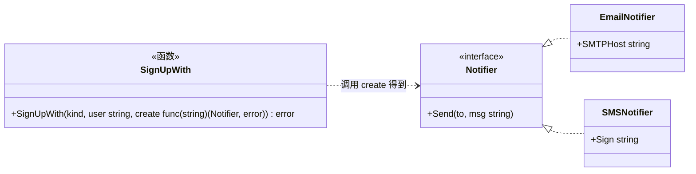

# 2.1 问题与思路

## 到处都在创建对象

商城要给用户发通知：注册欢迎、重置密码、订单发货……用户可以选邮件或短信。

{ .illus }

<p class="caption">不用自己调饮料，只是第一步。工厂方法的关键是：按键、出货的流程不变，负责制作的模块可以换。</p>

最直觉的写法是每个业务函数自己判断、自己创建：

```go
--8<-- "codes/creational/factorymethod/bad.go:bad"
```

| 痛点 | 后果 |
|---|---|
| 创建细节到处重复 | 改一次服务器地址或签名，要找遍所有业务函数 |
| 业务代码写死了创建方式 | 想接入新通知方式，或在测试里换成假对象，都得改流程 |

## 把创建交给可替换的函数

把分支收进一个函数，得到的是**简单工厂**：调用方不必自己造对象，但创建规则仍固定在该函数中。想换一整套创建规则，就把创建函数传给注册流程。

==注册流程决定何时创建，传入的函数决定如何创建==。GoF 原版把创建步骤留给子类重写；Go 用函数参数提供同样的扩展点。



<p class="caption">注册流程只认 Notifier 接口：调用传入的 create 拿到通知器，再用它发消息</p>

| 角色 | 本例中 |
|---|---|
| 使用产品的流程 | `SignUpWith` |
| 提供创建方式的函数 | `NewNotifier` 或 `Create` |
| 产品接口与具体产品 | `Notifier`、`EmailNotifier`、`SMSNotifier` 等 |

说白了，Go 里从简到繁有三档：

| 写法 | 什么时候用 |
|---|---|
| 调用方直接传一个造好的 `Notifier` 进来 | 只用一次、提前就能造好，最简单 |
| 一个 `NewNotifier(kind)` 函数集中创建（简单工厂） | 多处都要按名字创建，规则固定 |
| 把创建函数传进去（工厂方法） | 由流程决定**何时、创建几个**，如 `hmac.New(sha256.New, key)`：hmac 内部要自己新建哈希 |

「工厂方法」原指让子类重写一个创建方法；Go 没有子类，就是**一个创建函数当参数**。
