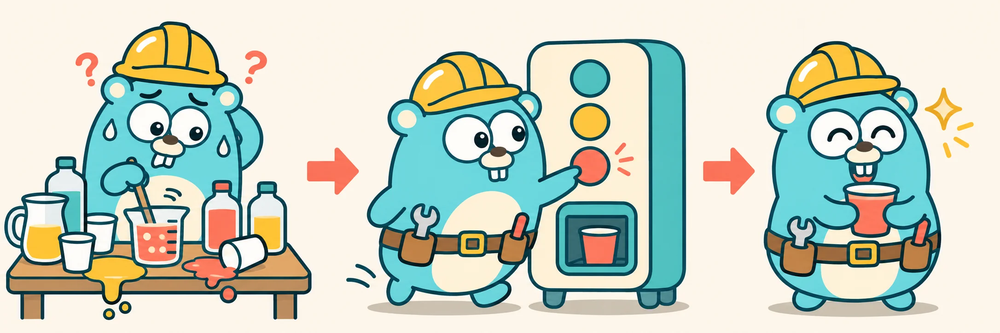
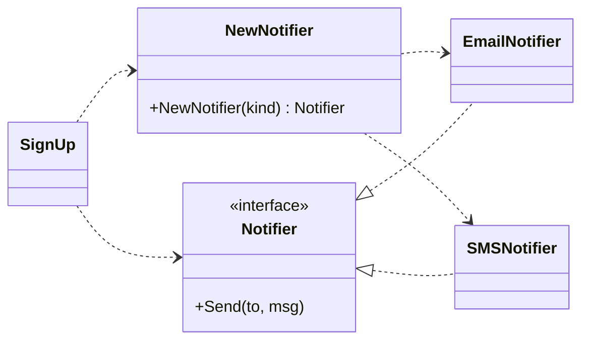

# 2.1 问题与思路

## 到处都在创建对象

商城要给用户发通知：注册欢迎、重置密码、订单发货……用户可以选邮件或短信。

{ .illus }

<p class="caption">每次都亲手调饮料，又慢又乱；交给售货机，按一下就拿到</p>

最直觉的写法是每个业务函数自己判断、自己创建：

```go
--8<-- "codes/creational/factorymethod/bad.go:bad"
```

| 痛点 | 后果 |
|---|---|
| 创建细节到处重复 | 改一次服务器地址或签名，要找遍所有业务函数 |
| 新增一种通知方式 | 每个 `switch` 都要改，漏一处就出错 |
| 业务代码依赖具体类型 | 想换实现或在测试里换成假对象，都很难 |

根本原因：**「用什么」和「怎么造」写在了一起**。

## 把「怎么造」交给工厂

1. 所有通知方式实现同一个接口 `Notifier`（产品）。
2. 写一个函数 `NewNotifier`（工厂），按名字决定创建哪种，返回接口。
3. 业务代码只调用工厂，只用接口。

==创建哪个类型只在工厂里决定一次，调用方只依赖接口==。



<p class="caption">SignUp 只认识工厂和接口，具体类型只有工厂知道</p>

| 角色 | 职责 | 本例中 |
|---|---|---|
| 产品（Product） | 定义统一接口 | `Notifier` |
| 具体产品 | 实现接口 | `EmailNotifier`、`SMSNotifier` |
| 工厂（Factory） | 决定创建哪个具体产品 | `NewNotifier` |
| 客户端 | 通过工厂拿到产品并使用 | `SignUp` |
