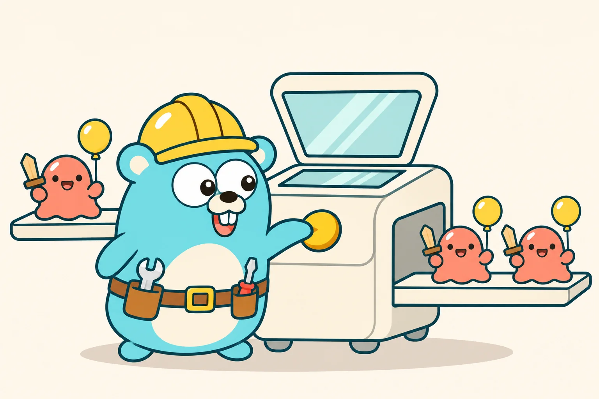

# 原型模式

:material-shape-outline: 创建型
:material-signal-cellular-1: 难度 入门
:material-fire: 使用频率 中

{ .cover }

!!! abstract ""

    捏好一只手办很费工夫，要更多只时，放进复印机按一下就行，想要不同的再在副本上改几笔。

    原型模式**复制一个配好的对象**来创建新对象，而不是每次从零构造；关键在于复制要**彻底**，副本和原型互不影响。

## 本章内容

| 节 | 内容 |
|---|---|
| [5.1 问题与思路](problem.md) | 相似对象一个个从零写，复制一份再改怎么解决 |
| [5.2 Go 实现](implementation.md) | 原型、Clone、原型注册表三步写完 |
| [5.3 深拷贝与标准库](copy.md) | 哪些字段会被共享，标准库的 Clone，什么时候用 |
| [5.4 小结](summary.md) | 重点回顾与常见问题 |
