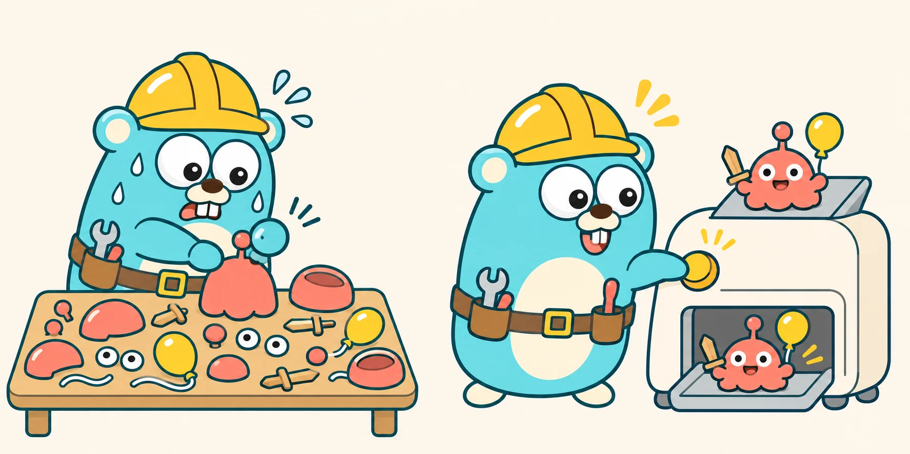
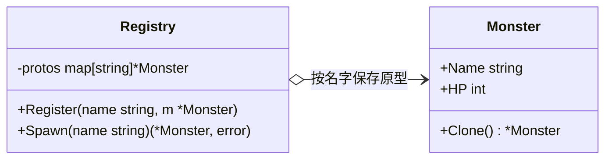

# 5.1 问题与思路

## 相似的对象，每次都从零写

游戏里要创建很多怪物：哥布林、精英哥布林、哥布林首领……它们大部分属性相同，只差血量、名字这几项。就像捏手办，每只都从一堆零件开始拼，又慢又容易拼错。

{ .illus }

<p class="caption">每只都从零件拼起很费工夫；有了一只样品，复制一份就行</p>

最直觉的写法是每种怪物写一个构造函数：

```go
--8<-- "codes/creational/prototype/bad.go:bad"
```

| 痛点 | 后果 |
|---|---|
| 相同的字段在每个函数里照抄 | 代码重复，越抄越长 |
| 哥布林加一个技能 | 所有变体都要跟着改，漏改就不一致 |
| 怪物模板来自配置文件，运行时才知道 | 代码里根本写不出对应的构造函数 |

根本原因：**创建新对象时，只会从零开始**，没法以一个配好的对象为起点。

## 复制一份，再改不同的部分

1. 先配好一个样品对象，叫**原型**。
2. 原型提供 `Clone` 方法，复制出一个完整、独立的副本。
3. 在副本上只改不同的部分；原型本身保持不变，可以一直复制。

常配一个**原型注册表**，按名字保存原型，需要时取出副本。原型可以在运行时从配置文件加载后登记，代码不必事先知道有哪些怪物。



<p class="caption">Registry 按名字保存原型，Spawn 交出的是 Clone 出的副本，原型本身从不交出去</p>

| 角色 | 职责 | 本例中 |
|---|---|---|
| 原型（Prototype） | 配好的样品，提供 Clone 复制自己 | `Monster` |
| 原型注册表（Registry） | 按名字保存原型，交出副本 | `Registry` |
| 客户端（Client） | 取副本，按需修改 | 调用方 |
