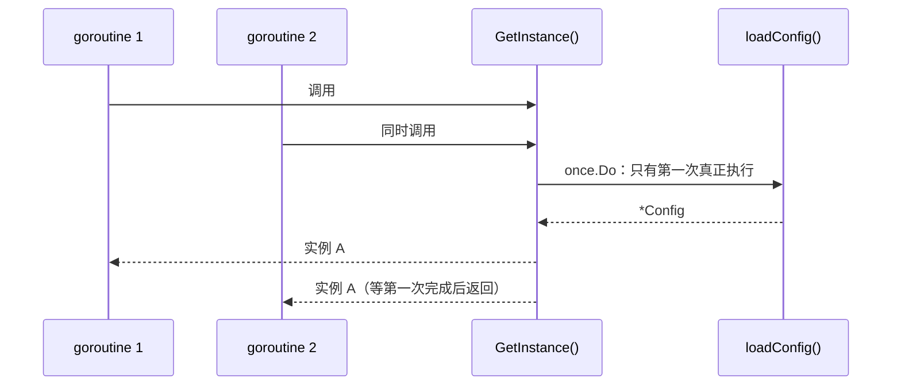

# 单例模式

!!! abstract "一句话"
    保证一个类型在整个程序中**只有一个实例**，并提供一个全局访问点。


<p class="caption">每家各挂一个钟，时间各不相同；全城只建一座钟楼，所有人看同一个时间。钟楼就是那个唯一的实例</p>

## 问题

程序里有些东西天然只该有一份：全局配置、日志器、数据库连接池。它们创建代价高，而且多份副本之间可能不一致。

最直觉的写法是「用到时检查一下，没有就创建」：

```go
--8<-- "codes/creational/singleton/bad.go:bad"
```

单线程下没问题。但 Go 程序天然是并发的：两个 goroutine 同时发现 `naive == nil`，配置就会被加载两次，还存在数据竞争（`go test -race` 会报出来）。

## 方案

把「创建」收进一个访问函数，并用同步原语保证**无论多少 goroutine 同时调用，创建只发生一次**。



| 角色 | 职责 | 本例中 |
|---|---|---|
| 单例类型 | 只允许存在一个实例的类型 | `Config` |
| 唯一实例 | 保存那一个实例 | 包级变量 `instance` |
| 访问点 | 外部获取实例的唯一入口 | `GetInstance()` |
| 同步原语 | 保证并发下只创建一次 | `sync.Once` |

## Go 实现

经典写法：`sync.Once` + 包级变量 + 访问函数。

```go
--8<-- "codes/creational/singleton/singleton.go:classic"
```

Go 1.21 起，`sync.OnceValue` 把这三件套合成一行，效果完全相同：

```go
--8<-- "codes/creational/singleton/singleton.go:idiom"
```

使用示例：

```go
--8<-- "codes/creational/singleton/example_test.go"
```

## 什么时候用

| 适合 | 不适合 |
|---|---|
| 真正全局唯一的资源：配置、日志器、连接池 | 只是为了「到处都能拿到」而图省事 |
| 创建代价高，希望按需延迟加载 | 需要多份隔离实例（多租户、多数据库） |
| 实例无状态或只读 | 单元测试需要替换成假对象 |

## 小结

- 单例 = **受控创建**的全局变量：只创建一次，全局可访问。
- Go 中用 `sync.Once` / `sync.OnceValue` 实现，天然并发安全，不要手写加锁和双重检查。
- 单例是全局状态，能用参数传递（依赖注入）时优先传递。

??? note "进阶：Go 惯用写法"
    | 写法 | 何时创建 | 适用 |
    |---|---|---|
    | 包级变量 `var cfg = loadConfig()` | 程序启动时（饿汉式） | 创建便宜、不会失败 |
    | `sync.OnceValue(f)` | 首次调用时（懒汉式） | 创建昂贵、可能用不到 |
    | `sync.OnceValues(f)` | 首次调用时，返回 `(T, error)` | 创建可能失败 |

    Go 社区更常见的不是「强制单例」，而是**默认实例**：包里提供一个开箱即用的全局实例，同时允许使用者自己 `New` 一个。这样既方便，又不妨碍测试。

??? note "进阶：标准库中的单例"
    - `mime.TypeByExtension`：首次调用时用 `sync.Once` 加载系统 MIME 类型表，之后复用。
    - `time.Local`：本地时区信息在首次使用时通过 `sync.Once` 懒加载。
    - 默认实例：`http.DefaultClient`、`http.DefaultServeMux`、`slog.Default()`。它们是全局共享的「默认那一个」，但你仍可以创建自己的实例——这是 Go 对单例的典型取舍。

??? note "进阶：单例与相似概念的区别"
    | 对比 | 区别 |
    |---|---|
    | 全局变量 | 单例多了「受控创建」：延迟加载、并发安全、只创建一次 |
    | 享元模式 | 享元共享**一组**按键区分的实例；单例只有**一个** |
    | 依赖注入 | 依赖注入把实例从外部传进来，便于替换；常用于取代单例 |

??? warning "常见误用"
    - **把单例当垃圾桶**：什么都往全局实例里塞，最终变成到处耦合的「上帝对象」。
    - **初始化失败无法重试**：`sync.Once` 只执行一次，即使失败或 panic 也不会再执行；`sync.OnceValues` 会缓存首次返回的 error。需要重试时，要自己用互斥锁实现。
    - **测试互相污染**：多个测试共享同一个全局实例，状态互相影响。把实例作为参数传入，测试时传假对象。
