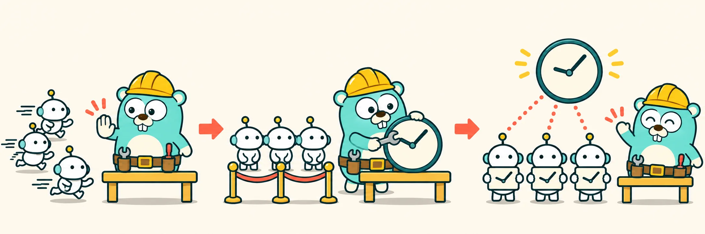

# 1.2 Go 实现

## 两种等价写法

Go 标准库的 `sync.Once` 正好提供「只执行一次」的保证。下面两种写法效果完全相同：先看经典写法理解原理，新代码用更短的 `sync.OnceValue`。

=== "经典写法"

    `sync.Once` + 不导出的包级变量 + 访问函数：

    ```go
    --8<-- "codes/creational/singleton/singleton.go:classic"
    ```

=== "Go 1.21+ 惯用写法"

    `sync.OnceValue` 把上面三件套合成一行：

    ```go
    --8<-- "codes/creational/singleton/singleton.go:idiom"
    ```

`once.Do(f)` 的规则只有两条：

1. 第一次调用执行 `f`；之后的调用直接返回，不再执行。
2. 多个 goroutine 同时调用时，其余调用会**等第一次执行完**才返回，所以拿到的一定是创建好的实例。

{ .illus }

<p class="caption">once.Do：同时到达的调用中只有一个去创建，其余排队等待，最后都拿到同一个实例</p>

## 使用示例

```go
--8<-- "codes/creational/singleton/example_test.go"
```

[:material-play: 在 Go Playground 运行](https://go.dev/play/p/cZeYy1z7jZO){ .md-button .md-button--primary target=_blank }

## 按创建时机选写法

上面的写法都是「首次调用时才创建」（懒汉式）。如果实例创建很便宜，直接用包级变量在启动时创建（饿汉式）更简单：

| 写法 | 何时创建 | 适用 |
|---|---|---|
| 包级变量 `var cfg = loadConfig()` | 程序启动时 | 创建便宜、不会失败 |
| `sync.Once` / `sync.OnceValue(f)` | 首次调用时 | 创建昂贵、可能用不到 |
| `sync.OnceValues(f)` | 首次调用时，返回 `(T, error)` | 创建可能失败 |
