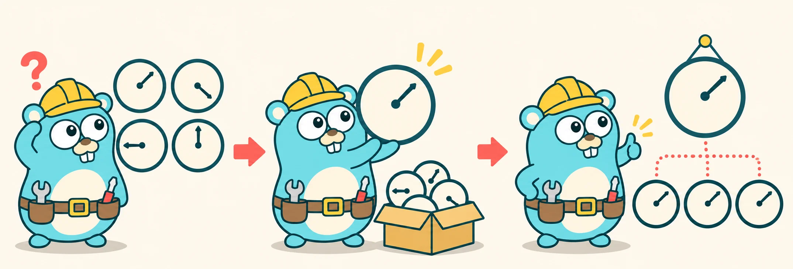
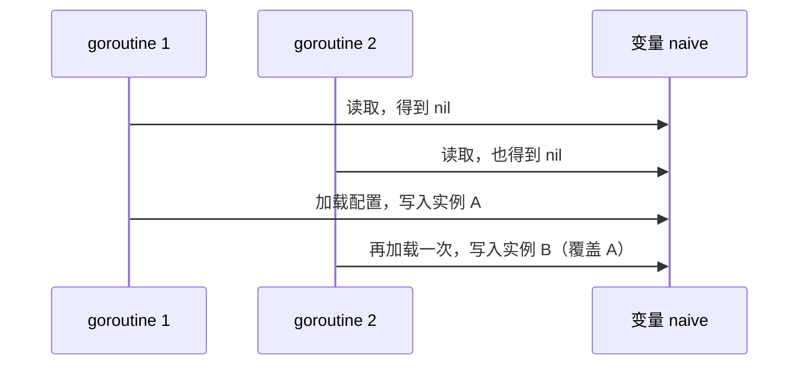

# 1.1 问题与思路

## 只该有一份的对象

程序里有些对象天然只该有一份：全局配置、日志器、数据库连接池。它们创建代价高，而且多份副本之间可能互相不一致。

{ .illus }

<p class="caption">多份副本各说各话；只留一份，所有使用者看到的就一定一致</p>

最直觉的写法是「用到时检查一下，没有就创建」：

```go
--8<-- "codes/creational/singleton/bad.go:bad"
```

顺序调用时，这段代码只会创建一份配置。如果两个 goroutine（独立执行的任务，见[附录 A](../../appendix/concurrency.md)）并发调用，它们都可能在写入前看到 `naive == nil`，于是各自创建一份。



<p class="caption">两个 goroutine 同时检查到 nil，配置被加载了两次</p>

加载可能执行两次，调用方也可能拿到不同的实例。这里对 `naive` 的读写没有同步，属于数据竞争。

## 让创建只发生一次

单例的思路分两步：

1. **藏起来**：实例存在不导出的包级变量里，外部拿不到变量本身。
2. **只留一个入口**：外部只能调用访问函数获取实例；函数内部保证==无论多少 goroutine 同时调用，创建都只发生一次==（下一节用 `sync.Once` 实现）。

| 角色 | 职责 | 本例中 |
|---|---|---|
| 单例类型 | 只允许存在一个实例的类型 | `Config` |
| 唯一实例 | 保存那一个实例，不导出 | 包级变量 `instance` |
| 访问点 | 外部获取实例的唯一入口 | `GetInstance()` |
