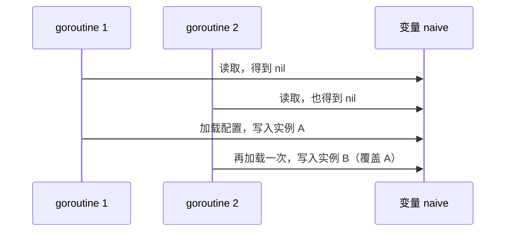
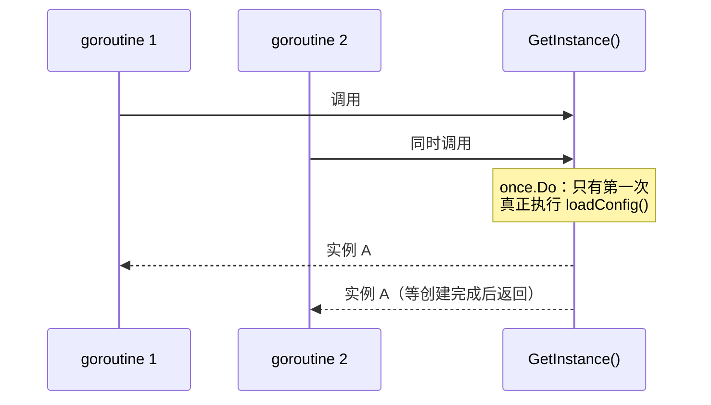
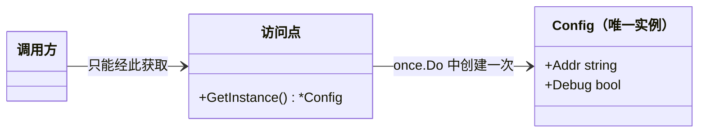

# 1.1 问题与思路

## 只该有一份的对象

程序里有些对象天然只该有一份：全局配置、日志器、数据库连接池。它们创建代价高，而且多份副本之间可能互相不一致。

最直觉的写法是「用到时检查一下，没有就创建」：

```go
--8<-- "codes/creational/singleton/bad.go:bad"
```

单线程下这段代码没问题。但 Go 程序天然是并发的：两个 goroutine 可能**同时**看到 `naive == nil`，于是各自创建一份配置。



<p class="caption">两个 goroutine 同时检查到 nil，配置被加载了两次</p>

后果有两个：昂贵的加载做了不止一次；`G1` 拿到的实例 A 随后被覆盖，两边用的不是同一份配置。此外这还是数据竞争，`go test -race` 会直接报错。

## 让创建只发生一次

单例的思路是：把实例藏起来，只留一个访问函数；在访问函数里用同步原语保证==无论多少 goroutine 同时调用，创建都只发生一次==。



<p class="caption">sync.Once 让第一次调用负责创建，其余调用等待并拿到同一个实例</p>

整个模式只有一个类型和一个访问点，结构非常简单：



<p class="caption">单例的结构：调用方拿不到变量本身，只能通过访问函数获取实例</p>

| 角色 | 职责 | 本例中 |
|---|---|---|
| 单例类型 | 只允许存在一个实例的类型 | `Config` |
| 唯一实例 | 保存那一个实例，不导出 | 包级变量 `instance` |
| 访问点 | 外部获取实例的唯一入口 | `GetInstance()` |
| 同步原语 | 保证并发下只创建一次 | `sync.Once` |
