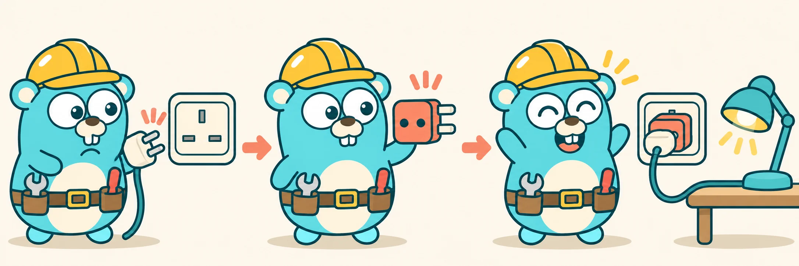

# Go 设计模式图解

用图和可运行的 Go 示例，讲清 GoF 的 23 个经典设计模式：它们解决什么问题、怎么用、什么时候不用。

{ .cover }

## 设计模式有什么用？

设计模式是**对常见设计问题的解决思路**，不是一段照抄的代码。它帮你判断哪些地方可能变化，以及怎样让一次修改少影响其他代码。给这种做法起个名字，也方便团队讨论。

比如，业务需要一种付款接口，但现有的电子钱包提供的是另一种接口。与其在每个付款入口重复转换，不如用一个[适配器](structural/adapter/index.md)集中做转换。将来钱包的接口变了，通常只改适配器，业务流程不用跟着改。

**先看问题，再选模式。** 如果直接调用就够清楚，而且没有重复的转换逻辑，不必为了用模式再加一层。

## 从哪里开始？

- **第一次学**：先读[适配器](structural/adapter/index.md) → [策略](behavioral/strategy/index.md) → [装饰器](structural/decorator/index.md)，分别看接口转换、算法选择和功能叠加。
- **按问题查**：打开[模式目录](patterns.md)，按创建对象、组合对象和对象协作来找。

每章先讲问题，再给 Go 实现和在线运行示例，最后讨论适用范围。不熟悉[接口与方法](appendix/interfaces.md)、[函数值与回调](appendix/callbacks.md)或[并发](appendix/concurrency.md)，可以读到相关示例时再查附录。

[查看 23 个模式](patterns.md){ .md-button .md-button--primary }
