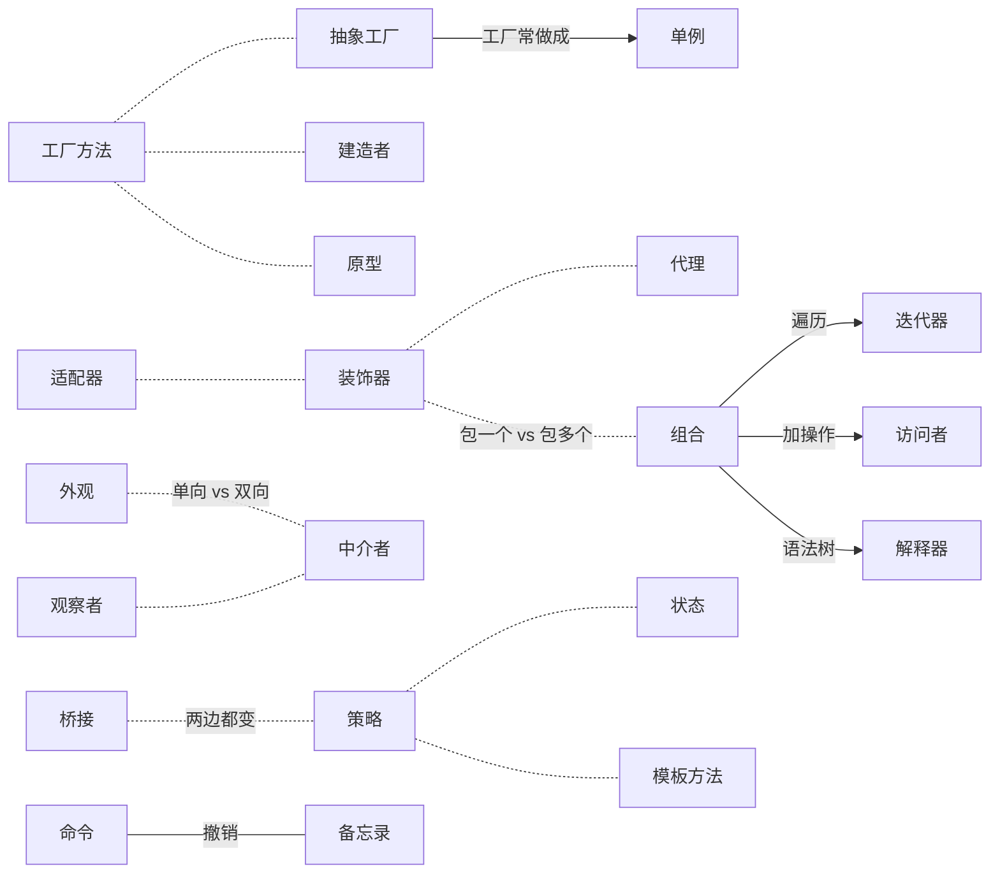

# 模式目录

按分类浏览：[创建型](creational/index.md) · [结构型](structural/index.md) · [行为型](behavioral/index.md)。也可以[按问题查](#by-problem)，或看[易混模式对比](compare.md)。

## 先读哪些 { #reading-order }

- **第一次学**：[适配器](structural/adapter/index.md) → [策略](behavioral/strategy/index.md) → [装饰器](structural/decorator/index.md)，再看[工厂方法](creational/factory-method/index.md)和[外观](structural/facade/index.md)。
- **按场景选**：例如，请求要过多道检查，先看[责任链](behavioral/chain-of-responsibility/index.md)；订单行为随阶段变化，先看[状态](behavioral/state/index.md)。
- **先了解用途**：[享元](structural/flyweight/index.md)用于大量对象共享数据，[访问者](behavioral/visitor/index.md)用于给固定类型加操作，[解释器](behavioral/interpreter/index.md)用于执行可配置的小语言。遇到这些问题再读实现。

章首页的「使用频率」是对设计思路在 Go 项目中有多常见的**经验判断**，不是行业统计、重要性排名或使用建议。配置项多，先试配置结构体；共享实例可以创建一次再传入，不必做成全局单例。

## 按问题查：我想…… { #by-problem }

| 我想…… | 用 |
|---|---|
| 全局只要一个实例，如配置、连接池 | [单例](creational/singleton/index.md) |
| 流程固定，但具体创建哪种对象可以换 | [工厂方法](creational/factory-method/index.md) |
| 一次换一整套配套的对象，如整套界面主题 | [抽象工厂](creational/abstract-factory/index.md) |
| 构造参数很多、大多可选 | [建造者](creational/builder/index.md) |
| 照着一个现成对象再造一个 | [原型](creational/prototype/index.md) |
| 把第三方类型接到自己的接口上 | [适配器](structural/adapter/index.md) |
| 不改原代码，给它叠加日志、计时、重试 | [装饰器](structural/decorator/index.md) |
| 访问一个对象前先做权限检查、缓存或延迟创建 | [代理](structural/proxy/index.md) |
| 给一堆复杂子系统一个简单入口 | [外观](structural/facade/index.md) |
| 文件夹和文件、部门和员工这样的树，统一处理 | [组合](structural/composite/index.md) |
| 发什么、怎么发都会变，不想每种消息里都 `switch` 渠道 | [桥接](structural/bridge/index.md) |
| 大量相似对象太占内存 | [享元](structural/flyweight/index.md) |
| 同一件事有多种算法，按条件切换 | [策略](behavioral/strategy/index.md) |
| 一处变化，自动通知多个关心它的地方 | [观察者](behavioral/observer/index.md) |
| 几个流程步骤顺序相同，只有个别步骤不同 | [模板方法](behavioral/template-method/index.md) |
| 遍历集合，又不暴露它的内部结构 | [迭代器](behavioral/iterator/index.md) |
| 请求要经过一串检查，每一关都可能拦下 | [责任链](behavioral/chain-of-responsibility/index.md) |
| 操作要排队、延后执行或支持撤销 | [命令](behavioral/command/index.md) |
| 一大堆 `switch 状态`，每个分支行为都不同 | [状态](behavioral/state/index.md) |
| 保存快照，以后恢复到之前的样子 | [备忘录](behavioral/memento/index.md) |
| 多个对象互相调用，关系乱成一团 | [中介者](behavioral/mediator/index.md) |
| 类型固定，却要不断给它们加新操作 | [访问者](behavioral/visitor/index.md) |
| 解析并执行一门简单的规则或表达式语言 | [解释器](behavioral/interpreter/index.md) |

## 模式关系图 { #map }

实线表示「常一起用」，虚线表示「容易混淆」，区别见[易混模式对比](compare.md)。

23 个模式之间常见的配合与混淆（责任链、享元与其他模式关系较弱，未画出）

