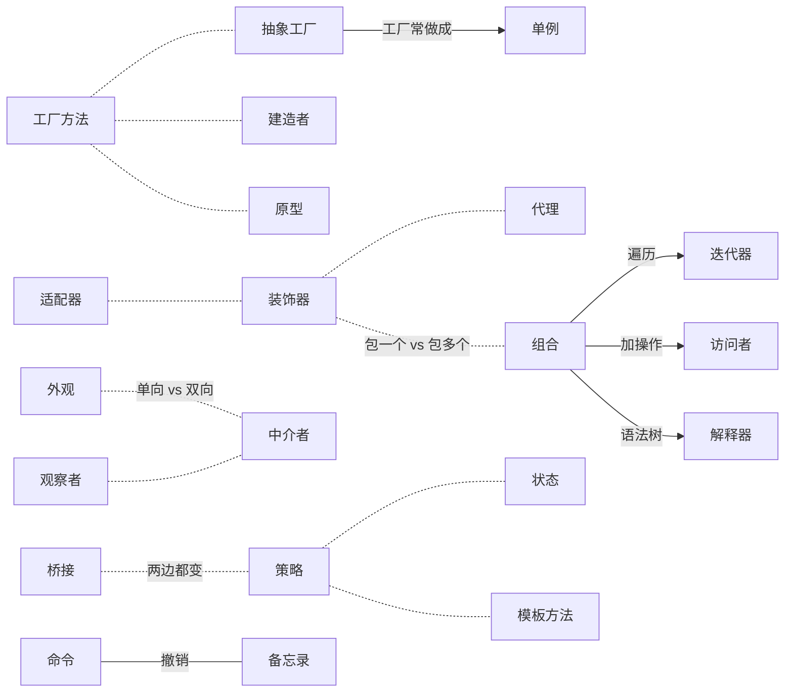

# 模式目录

按分类跳转：[创建型](#creational) · [结构型](#structural) · [行为型](#behavioral) · [按问题查](#by-problem) · [模式关系图](#map)

分不清相近的模式？看[易混模式对比](compare.md)。

## 创建型：怎么创建对象 { #creational }

| 章 | 模式 | 一句话 |
|---|---|---|
| 1 | [单例 Singleton](creational/singleton/index.md) | 只创建一个实例，并提供统一的访问入口 |
| 2 | [工厂方法 Factory Method](creational/factory-method/index.md) | 在固定流程中替换创建方式 |
| 3 | [抽象工厂 Abstract Factory](creational/abstract-factory/index.md) | 成套地创建相关对象 |
| 4 | [建造者 Builder](creational/builder/index.md) | 一步步组装复杂对象 |
| 5 | [原型 Prototype](creational/prototype/index.md) | 复制已有对象来创建新对象 |

## 结构型：怎么组合对象 { #structural }

| 章 | 模式 | 一句话 |
|---|---|---|
| 6 | [适配器 Adapter](structural/adapter/index.md) | 转换接口，让不兼容的类型一起工作 |
| 7 | [装饰器 Decorator](structural/decorator/index.md) | 层层包装，动态叠加功能 |
| 8 | [代理 Proxy](structural/proxy/index.md) | 用替身控制对真实对象的访问 |
| 9 | [外观 Facade](structural/facade/index.md) | 给复杂子系统一个简单入口 |
| 10 | [组合 Composite](structural/composite/index.md) | 把对象组成树，统一对待单个和整体 |
| 11 | [桥接 Bridge](structural/bridge/index.md) | 把两个可变维度拆开，各自变化 |
| 12 | [享元 Flyweight](structural/flyweight/index.md) | 共享对象中可复用的部分，节省内存 |

## 行为型：对象之间怎么协作 { #behavioral }

| 章 | 模式 | 一句话 |
|---|---|---|
| 13 | [策略 Strategy](behavioral/strategy/index.md) | 让同一件事可以换一种算法来做 |
| 14 | [观察者 Observer](behavioral/observer/index.md) | 一处变化，通知所有订阅者 |
| 15 | [模板方法 Template Method](behavioral/template-method/index.md) | 固定流程骨架，替换个别步骤 |
| 16 | [迭代器 Iterator](behavioral/iterator/index.md) | 不暴露内部结构地遍历集合 |
| 17 | [责任链 Chain of Responsibility](behavioral/chain-of-responsibility/index.md) | 请求沿链传递，直到有人处理或到达链尾 |
| 18 | [命令 Command](behavioral/command/index.md) | 把操作封装起来，便于排队或稍后执行 |
| 19 | [状态 State](behavioral/state/index.md) | 状态改变时，行为跟着改变 |
| 20 | [备忘录 Memento](behavioral/memento/index.md) | 保存并恢复对象状态 |
| 21 | [中介者 Mediator](behavioral/mediator/index.md) | 由一个中间人协调对象之间的交互 |
| 22 | [访问者 Visitor](behavioral/visitor/index.md) | 让已有类型接待访问者，以便添加新操作 |
| 23 | [解释器 Interpreter](behavioral/interpreter/index.md) | 组合并解释一门简单语言中的表达式 |

## 按问题查：我想…… { #by-problem }

| 我想…… | 用 |
|---|---|
| 全局只要一个实例，如配置、连接池 | [单例](creational/singleton/index.md) |
| 流程固定，但具体创建哪种对象可以换 | [工厂方法](creational/factory-method/index.md) |
| 一次换一整套配套的对象，如整套界面主题 | [抽象工厂](creational/abstract-factory/index.md) |
| 构造参数很多、大多可选 | [建造者](creational/builder/index.md) |
| 照着一个现成对象再造一个 | [原型](creational/prototype/index.md) |
| 把第三方类型接到自己的接口上 | [适配器](structural/adapter/index.md) |
| 不改原代码，给它叠加日志、计时、重试 | [装饰器](structural/decorator/index.md) |
| 访问一个对象前先做权限检查、缓存或延迟创建 | [代理](structural/proxy/index.md) |
| 给一堆复杂子系统一个简单入口 | [外观](structural/facade/index.md) |
| 文件夹和文件、部门和员工这样的树，统一处理 | [组合](structural/composite/index.md) |
| 两个维度都会变，不想写出 M×N 个类型 | [桥接](structural/bridge/index.md) |
| 大量相似对象太占内存 | [享元](structural/flyweight/index.md) |
| 同一件事有多种算法，按条件切换 | [策略](behavioral/strategy/index.md) |
| 一处变化，自动通知多个关心它的地方 | [观察者](behavioral/observer/index.md) |
| 几个流程步骤顺序相同，只有个别步骤不同 | [模板方法](behavioral/template-method/index.md) |
| 遍历集合，又不暴露它的内部结构 | [迭代器](behavioral/iterator/index.md) |
| 请求要经过一串检查，每一关都可能拦下 | [责任链](behavioral/chain-of-responsibility/index.md) |
| 操作要排队、延后执行或支持撤销 | [命令](behavioral/command/index.md) |
| 一大堆 `switch 状态`，每个分支行为都不同 | [状态](behavioral/state/index.md) |
| 保存快照，以后恢复到之前的样子 | [备忘录](behavioral/memento/index.md) |
| 多个对象互相调用，关系乱成一团 | [中介者](behavioral/mediator/index.md) |
| 类型固定，却要不断给它们加新操作 | [访问者](behavioral/visitor/index.md) |
| 解析并执行一门简单的规则或表达式语言 | [解释器](behavioral/interpreter/index.md) |

## 模式关系图 { #map }

实线表示「常一起用」，虚线表示「容易混淆」，区别见[易混模式对比](compare.md)。

23 个模式之间常见的配合与混淆（责任链、享元与其他模式关系较弱，未画出）

