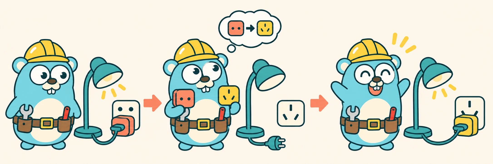

# 6.2 Go 实现

## 三步写完

**第 1 步**：目标接口，以及只依赖它的业务代码。

```go
--8<-- "codes/structural/adapter/adapter.go:target"
```

**第 2 步**：被适配者。这是已经存在的第三方代码，照原样使用，不做修改。

```go
--8<-- "codes/structural/adapter/wallet.go:adaptee"
```

**第 3 步**：适配器持有 `WalletClient`，在 `Pay` 中把调用翻译过去。

```go
--8<-- "codes/structural/adapter/adapter.go:adapter"
```

`var _ Payer = WalletAdapter{}` 是 Go 的常用写法：不产生任何运行时代码，只让编译器检查「适配器确实实现了目标接口」。值和指针的区别见[接口与方法](../../appendix/interfaces.md)。

!!! tip "适配器只做翻译"

    适配器只转换方法、单位和错误表示。限额检查、重试、记账等业务规则应写在业务代码或 SDK 中，否则换一个适配器时这些规则会悄悄丢掉。

## 使用示例

{ .illus }

<p class="caption">插座换了只换转换头，台灯不动：换一家支付时只需再写一个适配器，Checkout 一行不改</p>

```go
--8<-- "codes/structural/adapter/example_test.go:example"
```

[:material-play: 在 Go Playground 运行](https://go.dev/play/p/XT0D0oJWx2Q){ .md-button .md-button--primary target=_blank } [:material-github: 查看完整源码](https://github.com/caticat/design-pattern/tree/master/codes/structural/adapter){ .md-button target=_blank }

Playground 中还包含 [6.3](stdlib.md) 的函数适配器示例，可以一起运行。
