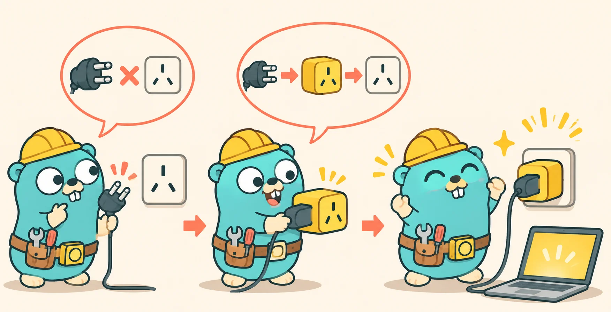

# 适配器模式

:material-shape-outline: 结构型
:material-signal-cellular-1: 难度 入门
:material-fire: 使用频率 高

{ .cover }

!!! abstract ""

    出国旅行，插头插不进当地的插座：不改插头，也不改插座，中间插一个转换头。

    适配器模式把一个已有类型的接口**转换**成调用方期望的接口，让**原本不兼容**的类型能一起工作。

## 本章内容

| 节 | 内容 |
|---|---|
| [6.1 问题与思路](problem.md) | 业务代码直接调用第三方 SDK 有什么问题，转换头怎么解决 |
| [6.2 Go 实现](implementation.md) | 目标接口、被适配者、适配器三步写完 |
| [6.3 函数适配器与标准库](stdlib.md) | 把函数适配成接口、标准库中的例子、什么时候用 |
| [6.4 小结](summary.md) | 重点回顾、常见问题与动手试试 |

**前置知识**：[附录 B 接口与方法](../../appendix/interfaces.md) · [附录 D 怎么读类图](../../appendix/class-diagram.md)　**相关对比**：[包一层](../../compare.md#wrappers)
