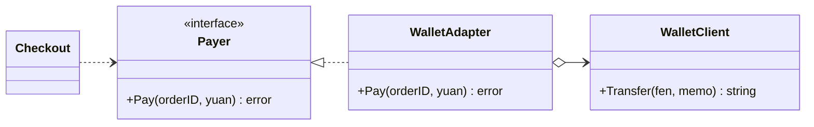

# 6.1 问题与思路

## 插头插不进插座

商城要接入一家第三方钱包收款。钱包 SDK 是别人写的，改不了，而且和商城的习惯处处不同：方法是 `Transfer(fen, memo)` 而不是 `Pay(orderID, yuan)`，金额以**分**计，失败时返回字符串状态码而不是 `error`。

{ .illus }

<p class="caption">插头和插座形状不同，直接插不进；中间加一个转换头，两边都不用改</p>

最直觉的写法是在业务代码里直接调用 SDK：

```go
--8<-- "codes/structural/adapter/bad.go:bad"
```

| 痛点 | 后果 |
|---|---|
| 元转分、判断状态码混在业务代码里 | 结算逻辑被第三方细节淹没 |
| 每个调用处都依赖 `WalletClient` | 换一家支付或 SDK 升级，处处要改 |
| 不调用真实 SDK 就没法跑 | 单元测试难写 |

根本原因：**业务代码直接依赖了别人的接口**。

## 中间加一个转换头

1. 商城按自己的需要定义接口 `Payer`（目标接口），业务代码只认它。
2. 写一个 `WalletAdapter`：对外实现 `Payer`，对内持有 `WalletClient`，把每次调用翻译过去。

==两边都不改，所有转换只写在适配器这一处==。



<p class="caption">Checkout 只认 Payer；WalletAdapter 一边实现 Payer，一边调用 WalletClient</p>

| 角色 | 职责 | 本例中 |
|---|---|---|
| 目标（Target） | 调用方期望的接口 | `Payer` |
| 被适配者（Adaptee） | 已有的、接口不匹配的类型 | `WalletClient` |
| 适配器（Adapter） | 实现目标接口，内部转调被适配者 | `WalletAdapter` |
| 客户端（Client） | 只通过目标接口使用功能 | `Checkout` |
