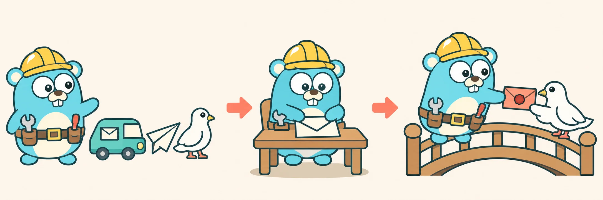

# 11.2 Go 实现

## 三步写完

**第 1 步**：「实现」这一边。`Sender` 只有一个方法，短信和邮件各写一个，彼此无关。

```go
--8<-- "codes/structural/bridge/sender.go:sender"
```

**第 2 步**：「抽象」这一边。`Normal` 持有一个 `Sender`，自己不发，交给它发。

```go
--8<-- "codes/structural/bridge/notice.go:notice"
```

**第 3 步**：再加一种消息。`Urgent` 只管拼出紧急格式，用哪个渠道发由创建时传进来的 `Sender` 决定。

```go
--8<-- "codes/structural/bridge/notice.go:urgent"
```

{ .illus }

<p class="caption">写信和送信分开：同一种渠道能发不同格式的信，同一种信也能换渠道发。</p>

!!! tip "加一个微信渠道"

    写一个实现 `Send` 的 `Wechat` 类型就够了，`Normal`、`Urgent` 一行不改。加一种消息同理，渠道一边不用动。

## 使用示例

```go
--8<-- "codes/structural/bridge/example_test.go:example"
```

[:material-play: 在 Go Playground 运行](https://go.dev/play/p/4sVm5WKOh-h){ .md-button .md-button--primary target=_blank } [:material-github: 查看完整源码](https://github.com/caticat/design-pattern/tree/master/codes/structural/bridge){ .md-button target=_blank }
