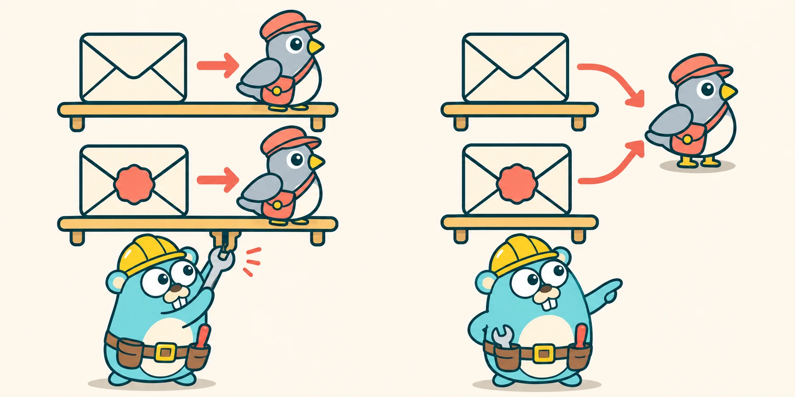
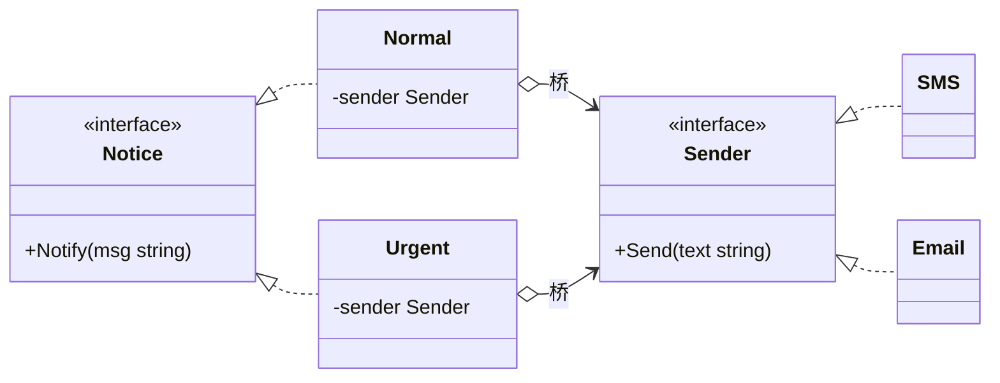

# 11.1 问题与思路

## 两件事在变，类型成倍增长

监控系统要发告警：消息分普通和紧急两种，渠道有短信和邮件两种，以后还会加微信、加定时消息。

{ .illus }

<p class="caption">每种组合绑成一份，柜子越塞越满；信和送信工具分开放，随取随配</p>

最直觉的写法：每种「消息 × 渠道」写一个类型：

```go
--8<-- "codes/structural/bridge/bad.go:bad"
```

| 痛点 | 后果 |
|---|---|
| 两个维度相乘 | 3 种消息 × 4 种渠道 = 12 个类型，大部分代码重复 |
| 两件事绑在一起 | 改紧急消息的格式，要改每个渠道的那份 |

根本原因：**两个独立变化的维度被写进了同一个类型**，任何一边变化都要牵动所有组合。

## 拆成两边，用字段接起来

1. 「怎么发」抽成接口 `Sender`，短信、邮件各自实现；「发什么」抽成接口 `Notice`，普通、紧急各自实现。
2. 消息里放一个 `Sender` 字段，==这个字段就是桥==：消息只管格式，发送交给另一边。



<p class="caption">左边管发什么，右边管怎么发；两边各自增加类型，互不影响</p>

| 角色 | 职责 | 本例中 |
|---|---|---|
| 抽象（Abstraction） | 调用方使用的高层接口，持有实现 | `Notice` |
| 扩展抽象（Refined Abstraction） | 抽象的不同变体 | `Normal`、`Urgent` |
| 实现（Implementor） | 底层操作的接口 | `Sender` |
| 具体实现（Concrete Implementor） | 底层操作的不同做法 | `SMS`、`Email` |
