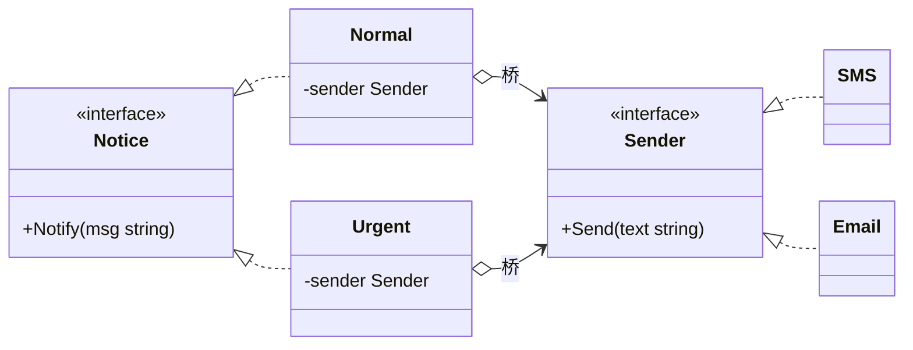

# 11.1 问题与思路

## 两件事写在一起，改一处动全身

监控系统要发告警：消息分普通和紧急两种，渠道有短信和邮件两种，以后还会加微信、加定时消息。

{ .illus }

<p class="caption">信和送信工具绑在一起，每加一样都要全部重来；分开放，随取随配</p>

最直觉的写法：渠道用一个字符串表示，每种消息里 `switch` 一下：

```go
--8<-- "codes/structural/bridge/bad.go:bad"
```

| 痛点 | 后果 |
|---|---|
| 加一个渠道 | 每种消息的 `switch` 都要加 `case`，漏改一处就发不出去 |
| 发送代码重复 | 真实的短信、邮件发送有几十行，每种消息里各抄一份 |

根本原因：**「怎么发」被写进了每一种「发什么」里**，两件事本来各自在变，却绑在了一起。

## 拆成两边，用字段接起来

1. 「怎么发」抽成接口 `Sender`，短信、邮件各自实现；「发什么」抽成接口 `Notice`，普通、紧急各自实现。
2. 消息里放一个 `Sender` 字段，==这个字段就是桥==：消息只管格式，发送交给另一边。



<p class="caption">左边管发什么，右边管怎么发；两边各自增加类型，互不影响</p>

| 角色 | 职责 | 本例中 |
|---|---|---|
| 抽象（Abstraction） | 调用方使用的高层接口，持有实现 | `Notice` |
| 扩展抽象（Refined Abstraction） | 抽象的不同变体 | `Normal`、`Urgent` |
| 实现（Implementor） | 底层操作的接口 | `Sender` |
| 具体实现（Concrete Implementor） | 底层操作的不同做法 | `SMS`、`Email` |

## 桥就是一个接口字段

代码上，桥接没有任何新东西：**结构体里放一个接口字段**，你在 Go 里天天这么写。它真正的内容是一个判断：==发现两件事各自在变，就拆开写，用一个字段接起来==。

名字来自 1994 年的 C++/Java。那时习惯用继承给每种组合写一个子类（`UrgentSMS`、`UrgentEmail`……），两边一扩展就是 M×N 个类；把两棵继承树用一个字段连起来，像在两岸之间架了一座桥。Go 没有继承，这种写法本来就是默认选择，记住「拆开 + 接口字段」即可。
