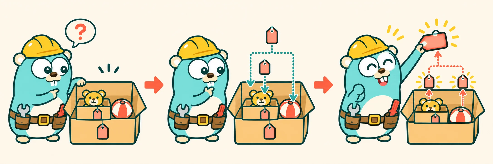

# 10.2 Go 实现

## 三步写完

**第 1 步**：共同接口。文件和目录都要回答这两个问题。

```go
--8<-- "codes/structural/composite/node.go:node"
```

**第 2 步**：叶子。文件没有子节点，大小直接返回。

```go
--8<-- "codes/structural/composite/node.go:leaf"
```

**第 3 步**：组合。目录把子节点存成 `Node`，算大小时逐个去问再加起来。

```go
--8<-- "codes/structural/composite/dir.go:composite"
```

{ .illus }

<p class="caption">问最外层的目录，它去问每个子节点；子目录再往下问，结果一层层加回来</p>

!!! tip "递归的终点是叶子"

    文件不再往下问，递归到这里就停。要是把目录加进它自己的子孙里形成环，`Size` 会无限递归，`Add` 时要避免。

## 使用示例

```go
--8<-- "codes/structural/composite/example_test.go:example"
```

[:material-play: 在 Go Playground 运行](https://go.dev/play/p/xq8x7UGqOKf){ .md-button .md-button--primary target=_blank } [:material-github: 查看完整源码](https://github.com/caticat/design-pattern/tree/master/codes/structural/composite){ .md-button target=_blank }
