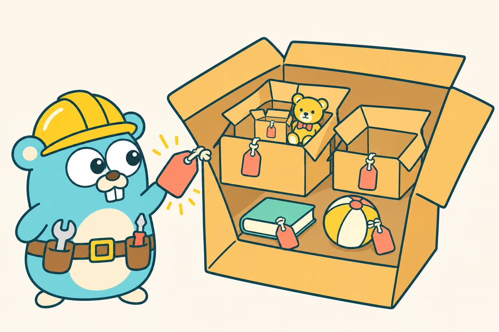

# 组合模式

:material-shape-outline: 结构型
:material-signal-cellular-1: 难度 入门
:material-fire: 使用频率 中

{ .cover }

!!! abstract ""

    文件夹里能放文件，也能放文件夹。问「这个文件夹多大」和问「这个文件多大」，问法一模一样。

    组合模式把单个对象和由它们组成的**树**一视同仁：调用方不用区分手里拿的是一片叶子还是一整棵树。

## 本章内容

| 节 | 内容 |
|---|---|
| [10.1 问题与思路](problem.md) | 文件和目录分开处理的麻烦，一个共同接口怎么解决 |
| [10.2 Go 实现](implementation.md) | 共同接口、叶子、组合与递归 |
| [10.3 Go 里的组合](stdlib.md) | error 也是一棵树、标准库中的例子、什么时候用 |
| [10.4 小结](summary.md) | 重点回顾与常见问题 |
