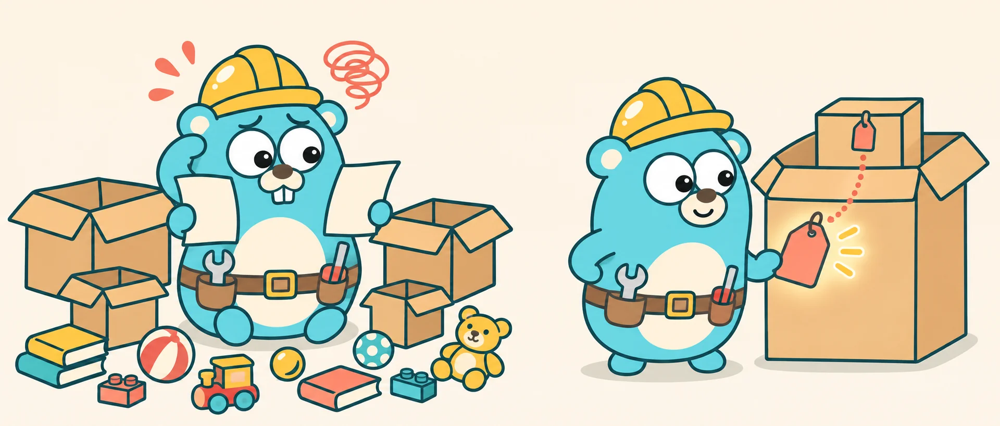
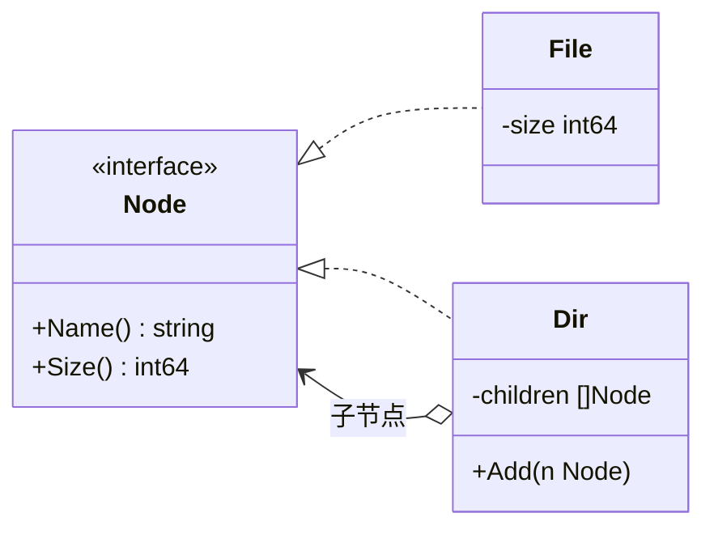

# 10.1 问题与思路

## 文件和目录分开处理

网盘要显示每个文件夹占多大空间。文件夹里有文件，也有子文件夹，子文件夹里还可以再套。

{ .illus }

<p class="caption">一层层拆开、分两张清单记，又慢又容易漏；每个箱子自己报总数，只问最外层就够了</p>

最直觉的写法：文件、目录各定义一个类型，统计时分开处理：

```go
--8<-- "codes/structural/composite/bad.go:bad"
```

| 痛点 | 后果 |
|---|---|
| 调用方要区分文件和目录 | 每个统计函数都写两种循环，还要自己递归 |
| 新增一种节点 | 目录类型、所有统计函数都要改一遍 |

根本原因：**文件和目录没有共同的样子**，调用方只能逐个分辨。

## 给它们一个共同接口

1. 文件 `File` 和目录 `Dir` 实现同一个接口 `Node`，==调用方只认 `Node`，不管它是文件还是目录==。
2. 目录的子节点也存成 `Node`。目录算大小时，只管问每个子节点，子目录会自己再往下问。



<p class="caption">文件和目录实现同一个接口；目录持有的子节点也是这个接口，于是可以无限嵌套</p>

| 角色 | 职责 | 本例中 |
|---|---|---|
| 组件（Component） | 叶子和组合的共同接口 | `Node` |
| 叶子（Leaf） | 没有子节点，自己完成工作 | `File` |
| 组合（Composite） | 持有子节点，把工作交给子节点再汇总 | `Dir` |
| 客户端（Client） | 只依赖接口 | 网盘页面 |
