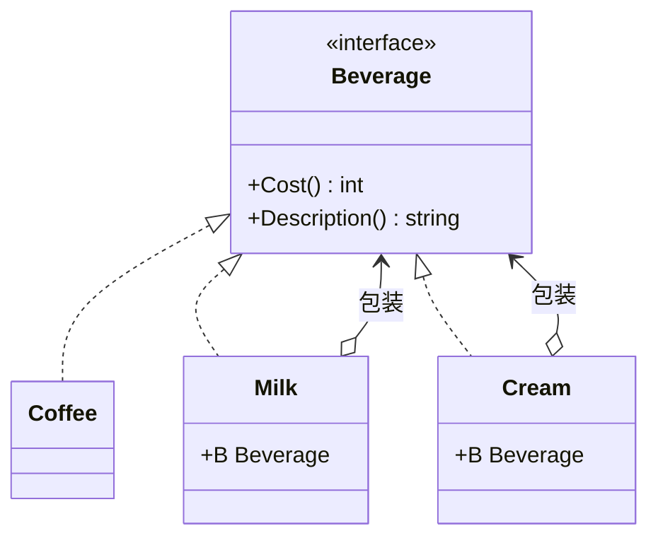
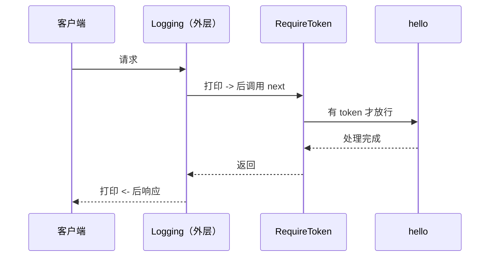

# 装饰器模式

!!! abstract "一句话"
    在**不修改原对象**的前提下，用一层层「包装」给它动态叠加新功能。


<p class="caption">一杯美式，加一层牛奶，再加一层奶油和焦糖。每加一层，杯子还是那个杯子，价格随之叠加——每一层配料就是一个装饰器</p>

## 问题

咖啡店有美式，还能加牛奶、加奶油。如果每种组合都写一个类型：

```go
--8<-- "codes/structural/decorator/bad.go:bad"
```

配料只有 2 种，就已经要 3 个组合类型；配料有 n 种，组合最多 2ⁿ−1 种。这就是**类爆炸**。而且改一次牛奶价格，要改好几个地方。

## 方案

让「配料」和「咖啡」实现**同一个接口**，配料内部再持有一个该接口的对象。包装之后仍是同一个接口，所以可以无限嵌套。



| 角色 | 职责 | 本例中 |
|---|---|---|
| 组件（Component） | 被装饰者与装饰器的共同接口 | `Beverage` |
| 具体组件 | 最原始的对象 | `Coffee` |
| 装饰器（Decorator） | 持有一个组件，在调用前后追加功能 | `Milk`、`Cream` |

## Go 实现

**第 1 步**：组件接口与原始对象。

```go
--8<-- "codes/structural/decorator/decorator.go:component"
```

**第 2 步**：装饰器持有一个 `Beverage`，先调用它，再叠加自己的部分。

```go
--8<-- "codes/structural/decorator/decorator.go:decorators"
```

使用示例：

```go
--8<-- "codes/structural/decorator/example_test.go:example"
```

### 实战：HTTP 中间件

Go 里最常见的装饰器是 **HTTP 中间件**：输入一个 `http.Handler`，返回一个包装后的 `http.Handler`。

```go
--8<-- "codes/structural/decorator/middleware.go:middleware"
```

多个中间件用 `Chain` 串起来，排在前面的在最外层：

```go
--8<-- "codes/structural/decorator/middleware.go:chain"
```

```go
--8<-- "codes/structural/decorator/example_test.go:example-chain"
```



## 什么时候用

| 适合 | 不适合 |
|---|---|
| 功能可以自由组合：日志、鉴权、缓存、限流 | 只需要一种固定组合，直接写更简单 |
| 不能或不想修改原对象（第三方库、标准库类型） | 需要改变接口本身（应该用适配器） |
| 想在运行时按配置决定叠加哪些功能 | 包装层的顺序难以说清，容易出错 |

## 小结

- 装饰器 = **同一接口的层层包装**，每层只做一件事。
- 用组合代替继承，避免「每种组合一个类型」的类爆炸。
- Go 的 HTTP 中间件、`io.Reader` 包装都是装饰器。

??? note "进阶：Go 惯用写法"
    Go 里装饰器通常写成**函数**而不是结构体：

    | 形式 | 例子 |
    |---|---|
    | `func(T) T` | `func(http.Handler) http.Handler` |
    | 构造函数接收并返回接口 | `bufio.NewReader(r io.Reader) *bufio.Reader` |

    接口越小，越容易被装饰。`io.Reader` 只有一个方法，所以标准库里围绕它的装饰器特别多。

??? note "进阶：标准库中的装饰器模式"
    - `bufio.NewReader(r)`：给任意 `io.Reader` 加上缓冲。
    - `gzip.NewReader(r)`：读出来的数据自动解压。
    - `io.LimitReader(r, n)`：最多只读 n 个字节。
    - `io.TeeReader(r, w)`：边读边把数据复制到 `w`。
    - `http.TimeoutHandler(h, d, msg)`、`http.StripPrefix(prefix, h)`：包装 `http.Handler`，加超时、去路径前缀。

    它们可以随意嵌套：`bufio.NewReader(gzip.NewReader(file))`。

??? note "进阶：装饰器与相似模式的区别"
    | 对比 | 区别 |
    |---|---|
    | 适配器 | 适配器**改变接口**；装饰器**保持接口不变**、增强功能 |
    | 代理 | 结构相似；代理侧重**控制访问**（权限、延迟加载），通常不叠加多层；装饰器侧重**叠加功能** |
    | 责任链 | 责任链中某一环可以**中断**，不再往下传；装饰器通常每层都会调用被包装者（中间件兼具两者特点） |

??? warning "常见误用"
    - **忽视包装顺序**：先鉴权再记日志，和先记日志再鉴权，结果不同。本例中 `Logging` 在外层，所以被拒绝的请求也会被记录。
    - **嵌套太深难调试**：十几层包装，出错时调用栈很长。每层保持单一职责，并给中间件起清楚的名字。
    - **依赖具体类型**：被包装后，类型断言 `b.(Coffee)` 会失败。使用方应只依赖接口。
