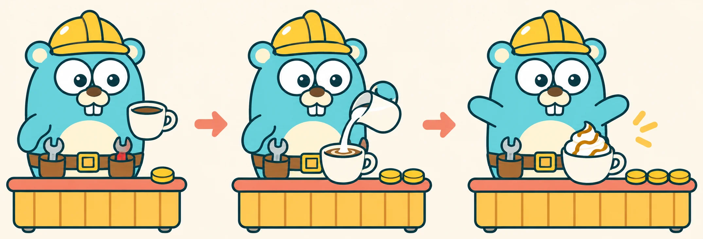

# 7.2 Go 实现

## 两步写完

**第 1 步**：组件接口与原始对象。

```go
--8<-- "codes/structural/decorator/decorator.go:component"
```

**第 2 步**：装饰器持有一个 `Beverage`，先调用它，再叠加自己的部分。

```go
--8<-- "codes/structural/decorator/decorator.go:decorators"
```

## 使用示例

{ .illus }

<p class="caption">每层的 Cost 先问里面那层，再加上自己的部分：15 → 15 + 3 → 15 + 3 + 5</p>

```go
--8<-- "codes/structural/decorator/example_test.go:example"
```

[:material-play: 在 Go Playground 运行](https://go.dev/play/p/iH-7sza-M-P){ .md-button .md-button--primary target=_blank }

Playground 中还包含 [7.3 HTTP 中间件](middleware.md) 的示例，可以一起运行。

## 写法选择

| 写法 | 例子 | 适合 |
|---|---|---|
| 结构体持有接口 | 本例 `Milk{B: b}` | 接口有多个方法 |
| 函数 `func(T) T` | `func(http.Handler) http.Handler`，见 7.3 | 接口只有一个方法 |
| 构造函数接收并返回接口 | `bufio.NewReader(r io.Reader)` | 包装后要加新方法（如 `ReadString`） |

!!! tip "接口越小，越容易被装饰"

    装饰器要实现被包装者的**全部**方法。`io.Reader` 只有一个 `Read`，所以标准库里围绕它的装饰器特别多。
