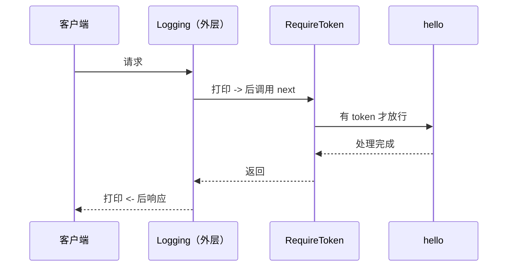

# 7.3 HTTP 中间件

## 中间件就是装饰器

Go 里最常见的装饰器是 **HTTP 中间件（middleware）**：输入一个 `http.Handler`，返回一个包装后的 `http.Handler`。

```go
--8<-- "codes/structural/decorator/middleware.go:middleware"
```

多个中间件用 `Chain` 串起来，排在前面的在最外层。例如 `Chain(hello, Logging(os.Stdout), RequireToken)`：

```go
--8<-- "codes/structural/decorator/middleware.go:chain"
```



<p class="caption">请求从外往里穿过每一层，响应再从里往外返回</p>

完整示例 `ExampleChain` 已包含在 [7.2 的 Playground](implementation.md) 中，可直接运行。

!!! warning "包装顺序会改变结果"

    本例 `Logging` 在外层，所以被 `RequireToken` 拒绝的请求也会被记录；顺序反过来，被拒绝的请求就不会出现在日志里。

## 标准库中的装饰器

| 装饰器 | 包装对象 | 叠加的功能 |
|---|---|---|
| `bufio.NewReader(r)` | `io.Reader` | 缓冲 |
| `gzip.NewReader(r)` | `io.Reader` | 读出时自动解压 |
| `io.TeeReader(r, w)` | `io.Reader` | 边读边复制到 `w` |
| `http.TimeoutHandler(h, d, msg)` | `http.Handler` | 超时 |
| `http.StripPrefix(prefix, h)` | `http.Handler` | 去掉路径前缀 |

包装后仍是 `io.Reader` 或 `http.Handler`，所以可以层层嵌套。例如读一个压缩文件：`file` 外面套 `gzip.NewReader` 解压，再套 `bufio.NewReader` 缓冲。

## 什么时候用

<div class="grid" markdown>

!!! success "适合"

    - 功能可以自由组合：日志、鉴权、缓存、限流
    - 不能或不想修改原对象（第三方库、标准库类型）
    - 运行时按配置决定叠加哪些功能

!!! failure "不适合"

    - 只有一种固定组合，直接写更简单
    - 需要改变接口本身（用适配器）
    - 包装层的顺序难以说清，容易出错

</div>
