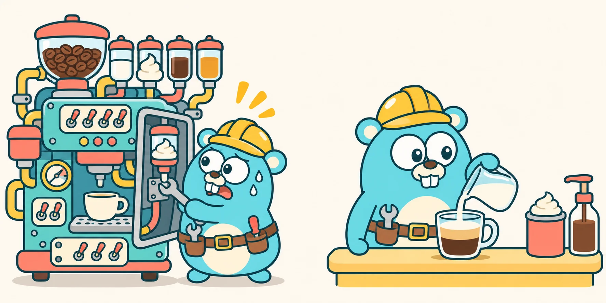
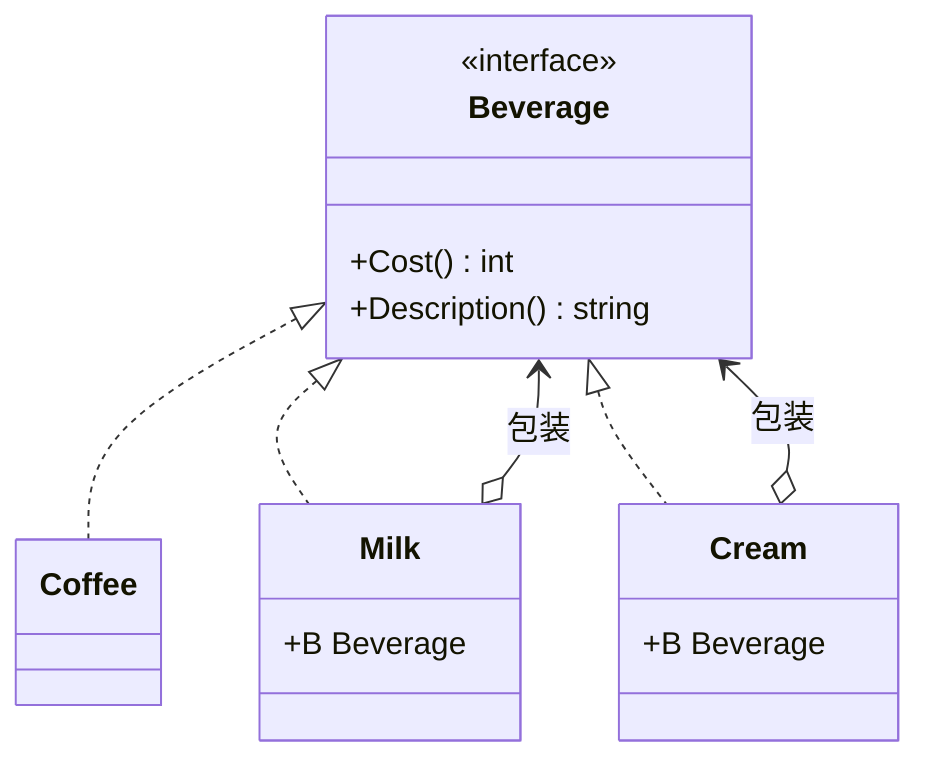

# 7.1 问题与思路

## 所有配料都塞进一个类型

咖啡店卖美式，可以加牛奶、加奶油，顾客想怎么配就怎么配。

{ .illus }

<p class="caption">每种配料都焊进机器里，加一种就得拆一次机器；配料单独放，现点现往杯里加</p>

最直觉的写法：订单上给每种配料一个开关，每个方法里挨个 `if`：

```go
--8<-- "codes/structural/decorator/bad.go:bad"
```

| 痛点 | 后果 |
|---|---|
| 加一种配料 | 改 `Order` 的字段，`Cost`、`Description` 各加一个 `if`，漏一处结果就错 |
| 加两份牛奶 | `bool` 表达不了，结构得改 |
| 别的包想加配料 | 改不了 `Order`，只能等它的作者改 |

根本原因：**每种附加功能都写进了同一个类型里**。配料只是几个价格、以后也不加时，这样写完全没问题；附加的东西一多、或者每层是一段行为（日志、鉴权、计时），就该拆开。

## 一层层包装

换个思路：配料不是新的咖啡类型，而是**套在咖啡外面的一层**。

1. 咖啡和配料实现**同一个接口** `Beverage`。
2. 配料内部持有一个 `Beverage`，计算时先问里面那层，再加上自己的部分。

==包装后仍是同一个接口，所以可以一层套一层，组合随用随拼==。加一种配料只写一个新类型，已有代码一行不改。

Go 里装饰器就是**一个结构体持有同一个接口**，或者一个函数 `func(http.Handler) http.Handler`（[7.3](middleware.md)）。名字里的「装饰」只是说它在原物外面加一层。



<p class="caption">装饰器既实现 Beverage，又持有一个 Beverage，所以能包装任何饮品，包括另一个装饰器</p>

| 角色 | 职责 | 本例中 |
|---|---|---|
| 组件（Component） | 被装饰者与装饰器的共同接口 | `Beverage` |
| 具体组件 | 最原始的对象 | `Coffee` |
| 装饰器（Decorator） | 持有一个组件，在调用它的前后追加功能 | `Milk`、`Cream` |
