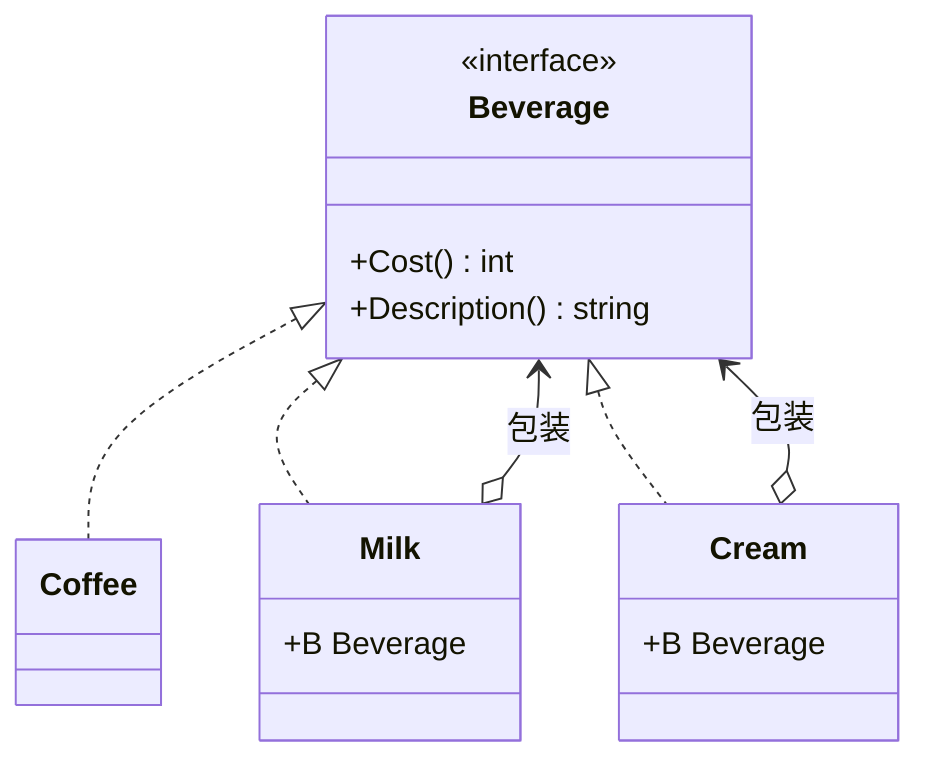

# 7.1 问题与思路

## 每种组合一个类型

咖啡店卖美式，可以加牛奶、加奶油，顾客想怎么配就怎么配。

{ .illus }

<p class="caption">把每种组合都做成成品，货架很快放不下；只备一杯基础咖啡和几种配料，现点现加</p>

最直觉的写法是每种组合写一个类型，相当于把每种组合都做成成品：

```go
--8<-- "codes/structural/decorator/bad.go:bad"
```

配料每多一种，组合数就翻一倍：

| 配料种数 | 需要的组合类型 |
|---|---|
| 2 | 3 |
| 3 | 7 |
| n | 2ⁿ − 1 |

这叫**类爆炸**。更麻烦的是，牛奶涨价要改所有带牛奶的类型。

## 一层层包装

换个思路：配料不是新的咖啡类型，而是**套在咖啡外面的一层**。

1. 咖啡和配料实现**同一个接口** `Beverage`。
2. 配料内部持有一个 `Beverage`，计算时先问里面那层，再加上自己的部分。

==包装后仍是同一个接口，所以可以一层套一层，组合随用随拼==。n 种配料只需要 n 个类型。



<p class="caption">装饰器既实现 Beverage，又持有一个 Beverage，所以能包装任何饮品，包括另一个装饰器</p>

| 角色 | 职责 | 本例中 |
|---|---|---|
| 组件（Component） | 被装饰者与装饰器的共同接口 | `Beverage` |
| 具体组件 | 最原始的对象 | `Coffee` |
| 装饰器（Decorator） | 持有一个组件，在调用它的前后追加功能 | `Milk`、`Cream` |
