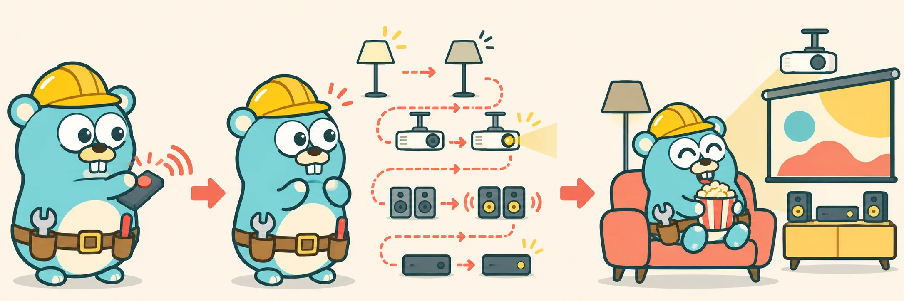

# 9.2 Go 实现

## 三步写完

**第 1 步**：子系统。每台设备各管各的，彼此不认识，也不知道外观的存在。

```go
--8<-- "codes/structural/facade/theater.go:subsystem"
```

**第 2 步**：外观结构体，持有全部设备。字段小写，调用方看不到具体设备。本例的设备都是可直接使用的零值结构体；真实项目中的设备若需要初始化，在 `NewHomeTheater` 里创建或由参数传入。

```go
--8<-- "codes/structural/facade/facade.go:facade"
```

**第 3 步**：一键方法。步骤和顺序只在这里写一次。

```go
--8<-- "codes/structural/facade/facade.go:methods"
```

{ .illus }

<p class="caption">按一次键，外观按顺序依次启动各个设备，调用方只等着看</p>

!!! tip "外观不是墙"

    外观只是多了一个方便的入口，不禁止直接使用子系统：想单独调音量，照样可以 `var s Speaker; s.Volume(50)`。

## 使用示例

```go
--8<-- "codes/structural/facade/example_test.go:example"
```

[:material-play: 在 Go Playground 运行](https://go.dev/play/p/qPem8_XfZLW){ .md-button .md-button--primary target=_blank } [:material-github: 查看完整源码](https://github.com/caticat/design-pattern/tree/master/codes/structural/facade){ .md-button target=_blank }
