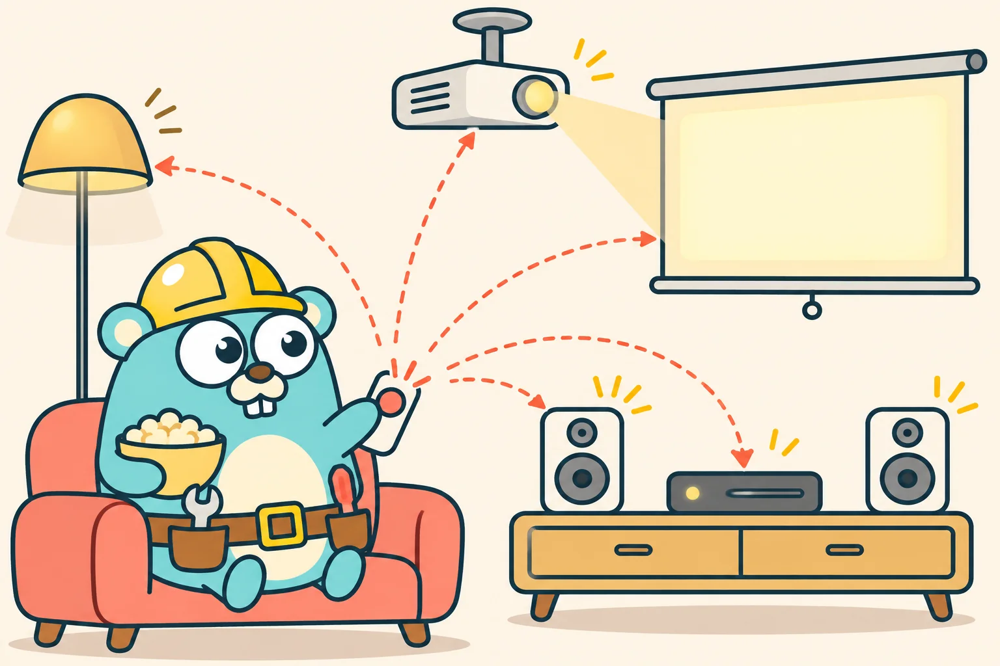

# 外观模式

:material-shape-outline: 结构型
:material-signal-cellular-1: 难度 入门
:material-fire: 使用频率 高

{ .cover }

!!! abstract ""

    看电影要调灯光、开投影、开音响、按播放；家庭影院的遥控器上只有一个「观影」键，按下去全部按顺序办好。

    外观模式给一组复杂的子系统提供一个**简单的统一入口**，调用方只和这个入口打交道。

## 本章内容

| 节 | 内容 |
|---|---|
| [9.1 问题与思路](problem.md) | 调用方要记住一长串步骤的麻烦，一个入口怎么解决 |
| [9.2 Go 实现](implementation.md) | 子系统、外观结构体与一键方法 |
| [9.3 Go 里的外观](stdlib.md) | 一个函数也是外观、标准库中的例子、什么时候用 |
| [9.4 小结](summary.md) | 重点回顾、常见问题与动手试试 |

**前置知识**：[附录 D 怎么读类图](../../appendix/class-diagram.md)　**相关对比**：[包一层](../../compare.md#wrappers) · [对象之间传消息](../../compare.md#messaging)
