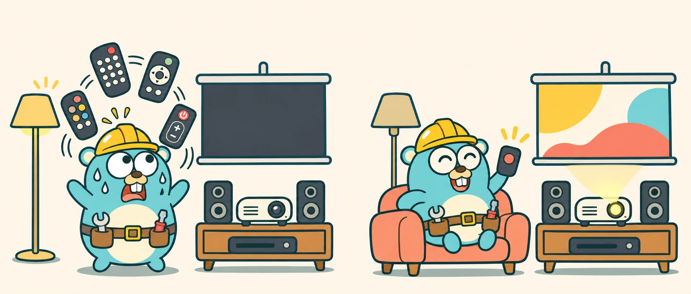
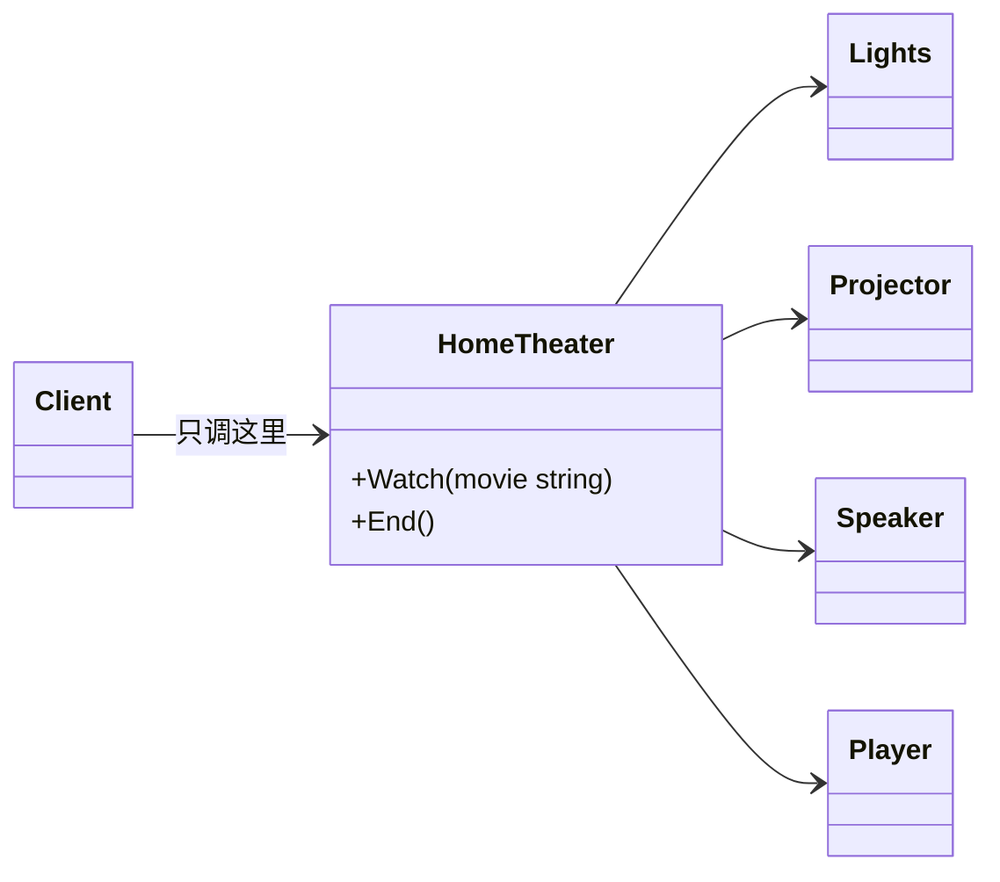

# 9.1 问题与思路

## 每个入口都要记住六步

家里有灯光、投影仪、音响、播放器四台设备。想看电影，得按顺序操作六步。

{ .illus }

<p class="caption">四个遥控器各管一台设备，顺序全靠自己记；换成一个按键，顺序由遥控器记住</p>

最直觉的写法：谁想看电影，谁就自己把六步写一遍：

```go
--8<-- "codes/structural/facade/bad.go:bad"
```

| 痛点 | 后果 |
|---|---|
| 步骤和顺序由调用方记住 | 手机 App、语音助手各抄一遍，漏一步或顺序错就出问题 |
| 调用方依赖全部设备 | 换一台投影仪、多一个开机步骤，所有调用方都要改 |

根本原因：**调用方直接面对整个子系统**，本该由一处负责的流程散落在各处。

## 加一个统一入口

1. 新建**外观** `HomeTheater`，由它持有全部设备。
2. 外观提供 `Watch`、`End` 两个方法，把步骤和顺序写在里面。==调用方只调一个方法，不再认识任何设备==。



<p class="caption">调用方只依赖外观；外观再去调用各个设备</p>

| 角色 | 职责 | 本例中 |
|---|---|---|
| 外观（Facade） | 提供简单入口，按正确顺序调用子系统 | `HomeTheater` |
| 子系统（Subsystem） | 各自完成具体工作，不知道外观的存在 | `Lights`、`Projector`、`Speaker`、`Player` |
| 客户端（Client） | 只调用外观 | 手机 App、语音助手 |
