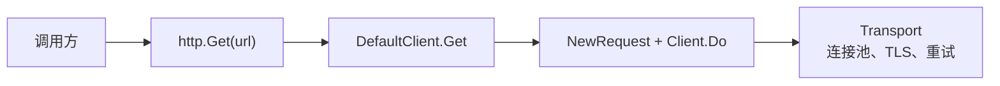

# 9.3 Go 里的外观

## 一个函数也是外观

外观不一定是结构体。Go 里更常见的是**包级函数**：把几步常用操作包成一个函数。读文件就是例子：

```go
--8<-- "codes/structural/facade/stdlib.go:manual"
```

`os.ReadFile` 内部仍是打开、读取、关闭，只是这些步骤由 `os` 包写一次，调用方不用再管。

## 标准库中的外观

| 外观 | 背后的步骤 |
|---|---|
| `os.ReadFile` / `os.WriteFile` | 打开文件、读写、关闭 |
| `http.Get`（`net/http`） | 构造 `Request`，交给 `DefaultClient`，由 `Transport` 建连接、发请求 |
| `(*exec.Cmd).Output`（`os/exec`） | 准备输出缓冲、启动进程、等待退出、收集错误输出 |
| `json.Marshal`（`encoding/json`） | 准备缓冲区、编码器按类型递归编码 |

`http.Get` 一层层往下，每一层都是对下一层的简化：



<p class="caption">需要简单用法就调 http.Get；需要超时、自定义请求头时，再往下一层用 Client 和 Request</p>

## 外观、适配器、代理

三者都「包住」别的对象，区别在目的：

| | 外观 | 适配器 | 代理 |
|---|---|---|---|
| 目的 | **简化**：给一组对象一个简单入口 | **转换**：把接口改成调用方要的样子 | **控制**：决定能不能、何时访问 |
| 包住几个 | 通常多个 | 通常一个 | 一个 |
| 接口 | 新定义的、更简单 | 调用方已有的接口 | 与真实对象相同 |

## 什么时候用

<div class="grid" markdown>

!!! success "适合"

    - 子系统步骤多、顺序有讲究，多处调用方都要用
    - 想让调用方只依赖一个入口，子系统换了也不受影响
    - 给复杂的库包一层，只暴露项目里真正用到的几个操作

!!! failure "不适合"

    - 子系统本来就简单，一两步就完成，多包一层只是绕路
    - 每个调用方需要的步骤都不一样，外观会越长越大
    - 想限制访问或改接口，那是代理或适配器的事

</div>
