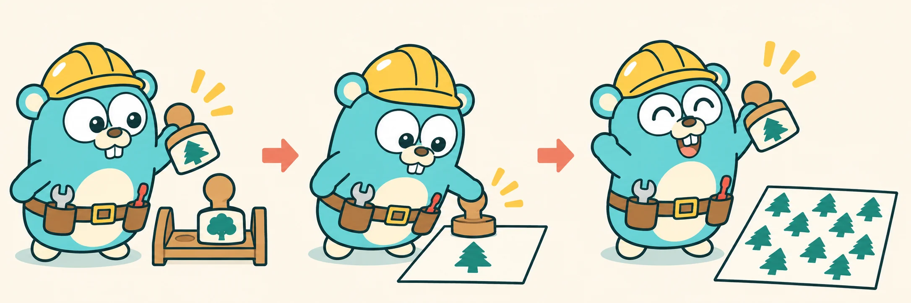

# 12.2 Go 实现

## 三步写完

**第 1 步**：享元。只放不变的名字和贴图；位置每棵都不同，作为 `Draw` 的参数传进来。

```go
--8<-- "codes/structural/flyweight/tree.go:type"
```

**第 2 步**：享元工厂。用 map 缓存，已有就直接返回，没有才加载。

```go
--8<-- "codes/structural/flyweight/factory.go:factory"
```

**第 3 步**：树只存位置和一个指针，种树时通过工厂拿享元。

```go
--8<-- "codes/structural/flyweight/factory.go:forest"
```

{ .illus }

<p class="caption">印章只刻一次；每次盖章只需决定盖在哪里</p>

!!! tip "享元必须不可变"

    十万棵树共用同一个 `TreeType`，改它一处，所有树都跟着变。所以字段不导出，创建后也不修改。这是包内约定，Go 不会在语言层面强制只读；跨包公开共享对象时，应让共享数据本身不可变（如 `string`），或只返回副本。

## 使用示例

```go
--8<-- "codes/structural/flyweight/example_test.go:example"
```

[:material-play: 在 Go Playground 运行](https://go.dev/play/p/jkPS4JHymVV){ .md-button .md-button--primary target=_blank } [:material-github: 查看完整源码](https://github.com/caticat/design-pattern/tree/master/codes/structural/flyweight){ .md-button target=_blank }
