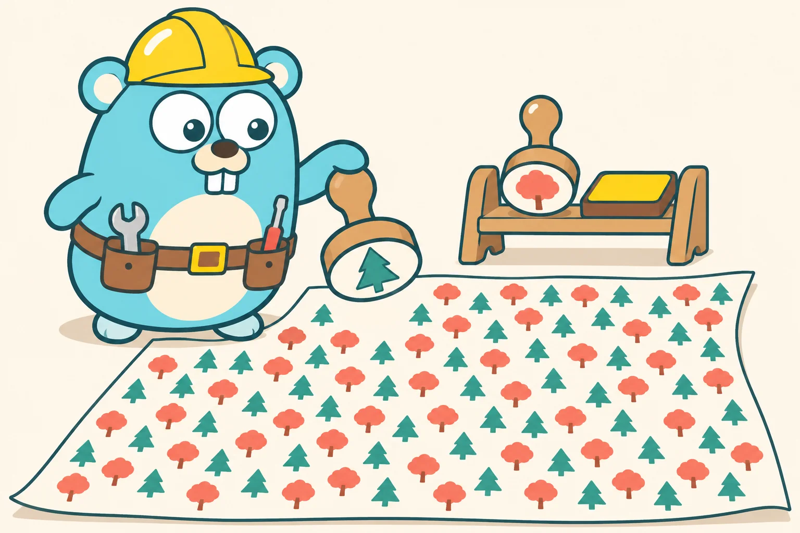

# 享元模式

:material-shape-outline: 结构型
:material-signal-cellular-2: 难度 进阶
:material-fire: 使用频率 低

{ .cover }

!!! abstract ""

    游戏地图上有十万棵树，但只有松树、橡树几种。每棵树都存一份贴图，内存很快就不够了。

    享元模式把对象里**不变、可共享**的部分抽出来只存一份，每个对象只保留自己独有的那一小部分：十万棵树，两份贴图。

## 本章内容

| 节 | 内容 |
|---|---|
| [12.1 问题与思路](problem.md) | 重复数据吃光内存，拆出共享部分怎么解决 |
| [12.2 Go 实现](implementation.md) | 享元、享元工厂、只存位置的树 |
| [12.3 Go 里的享元](stdlib.md) | unique 包、标准库中的例子、什么时候用 |
| [12.4 小结](summary.md) | 重点回顾、常见问题与动手试试 |

**前置知识**：[附录 A 并发](../../appendix/concurrency.md) · [附录 D 怎么读类图](../../appendix/class-diagram.md)
