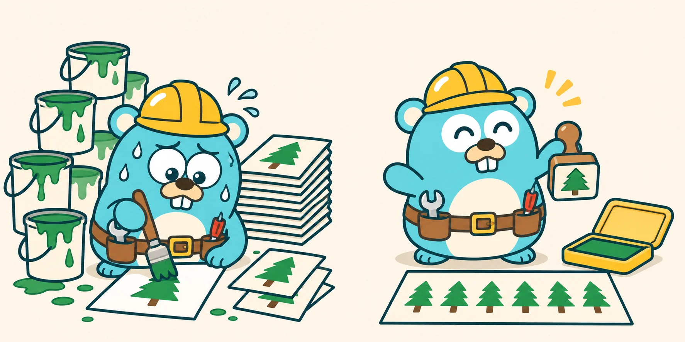
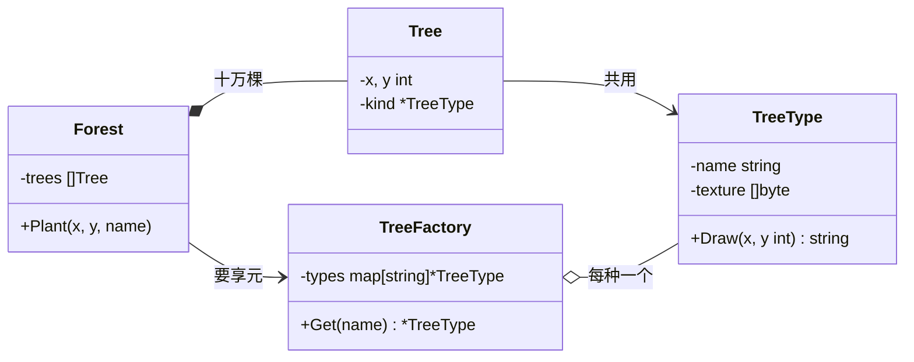

# 12.1 问题与思路

## 每个对象都背着一份重复数据

游戏地图要种十万棵树。每棵树有自己的位置，但同一种树的名字和贴图完全一样，贴图每份 1 MB。

{ .illus }

<p class="caption">一枚印章可以盖在不同位置；同种树共享同一份名字和贴图，每棵树各自记录位置。</p>

最直觉的写法：贴图直接放在每棵树里：

```go
--8<-- "codes/structural/flyweight/bad.go:bad"
```

| 痛点 | 后果 |
|---|---|
| 相同的贴图存了十万份 | 内存占用和树的数量成正比，很快耗尽 |
| 每棵树都重新加载 | 种树越多越慢，大部分时间在做重复工作 |

根本原因：**不变的共享数据和每个对象独有的数据放在了一起**，共享的部分也跟着复制。

## 共享不变的部分

1. 把对象拆成两部分：==不变、可共享的**内部状态**（名字、贴图）放进享元 `TreeType`==；每棵树独有的**外部状态**（位置）留在 `Tree` 里。
2. 用享元工厂 `TreeFactory` 按名字缓存享元：同名只创建一次，之后都返回同一个。



<p class="caption">十万棵 Tree 只存位置，指向工厂里仅有的几个 TreeType</p>

| 角色 | 职责 | 本例中 |
|---|---|---|
| 享元（Flyweight） | 保存可共享的内部状态，创建后不可修改 | `TreeType` |
| 享元工厂（Flyweight Factory） | 缓存享元，相同的只创建一次 | `TreeFactory` |
| 上下文（Context） | 保存外部状态，引用享元 | `Tree` |
| 客户端（Client） | 通过工厂拿享元，不自己创建 | `Forest` |
