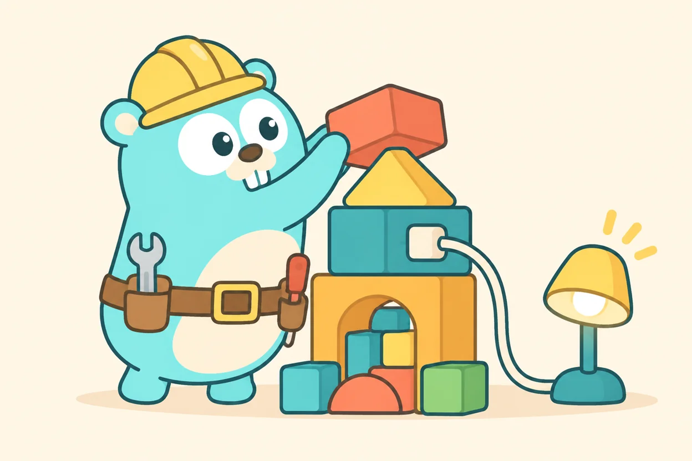

# 结构型模式

{ .cover }

关注**怎么组合对象**：在不修改已有代码的前提下，把类型拼装成更大、更灵活的结构。

| 章 | 模式 | 解决的问题 |
|---|---|---|
| 6 | [适配器](adapter/index.md) | 接口不兼容 |
| 7 | [装饰器](decorator/index.md) | 想动态叠加功能，又不想改原对象 |
| 8 | [代理](proxy/index.md) | 访问对象前后需要控制（权限、缓存、延迟加载） |
| 9 | [外观](facade/index.md) | 子系统太复杂，调用方只想要简单入口 |
| 10 | [组合](composite/index.md) | 树形结构中，单个对象和整体要统一处理 |
| 11 | [桥接](bridge/index.md) | 两个维度各自变化，组合数量爆炸 |
| 12 | [享元](flyweight/index.md) | 大量相似对象占用太多内存 |

接口对不上，用适配器；接口不变、要叠加功能，用装饰器；重点是控制能不能访问、何时访问，用代理。
