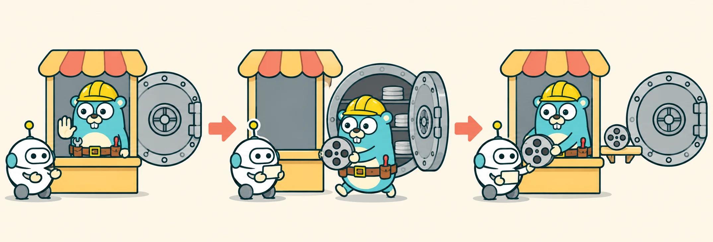

# 8.2 Go 实现

## 三步写完

**第 1 步**：公共接口和真实对象。`LoadHDVideo` 代表昂贵的创建过程，调用一次就打印一行「加载」。

```go
--8<-- "codes/structural/proxy/video.go:subject"
```

**第 2 步**：代理结构体。只记下片名和是否会员专享，`real` 先留空，所以创建代理几乎不花时间。

```go
--8<-- "codes/structural/proxy/proxy.go:proxy"
```

**第 3 步**：代理的 `Play`，依次做三件事：检查、需要时才创建、转交。

```go
--8<-- "codes/structural/proxy/proxy.go:play"
```

{ .illus }

<p class="caption">不满足条件直接拒绝，片库碰都不碰；第一次需要才去取；取过的直接复用</p>

!!! tip "多个 goroutine 同时播放"

    `if p.real == nil` 不是并发安全的，可能加载两次，改法见 [8.4 小结](summary.md)。

## 使用示例

```go
--8<-- "codes/structural/proxy/example_test.go:example"
```

[:material-play: 在 Go Playground 运行](https://go.dev/play/p/TODO){ .md-button .md-button--primary target=_blank }
