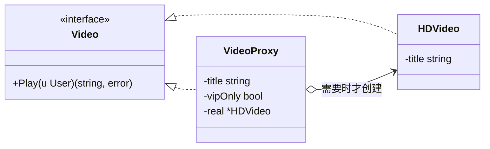

# 8.1 问题与思路

## 用不上的先加载，检查到处抄

视频网站首页列出很多部高清视频：每部创建时都要读进整部影片，很慢；有的只有会员能看。

{ .illus }

<p class="caption">把所有胶片都扛出来又慢又累；守在窗口，验过卡再取要的那一卷</p>

最直觉的写法：首页一打开就加载全部视频，会员检查写在播放的地方：

```go
--8<-- "codes/structural/proxy/bad.go:bad"
```

| 痛点 | 后果 |
|---|---|
| 首页一打开就加载全部 | 启动很慢，内存浪费在没人看的视频上 |
| 会员检查写在调用处 | 每个播放入口都要抄一遍，漏一处就能绕过 |

根本原因：**调用方直接拿着真实对象**，创建时机和访问检查都只能由调用方自己管。

## 放一个替身在前面

1. 真实视频 `HDVideo` 和**代理** `VideoProxy` 实现同一个接口 `Video`，==调用方分不出也不必分出是哪一个==。
2. 调用方只拿到代理。代理先检查，第一次需要时才创建真实对象，再把调用转交给它。



<p class="caption">代理和真实视频实现同一个接口；真实视频由代理自己创建并持有</p>

| 角色 | 职责 | 本例中 |
|---|---|---|
| 抽象主题（Subject） | 代理和真实对象共同的接口 | `Video` |
| 真实主题（Real Subject） | 真正干活的对象，往往昂贵或敏感 | `HDVideo` |
| 代理（Proxy） | 控制访问，再转交给真实主题 | `VideoProxy` |
| 客户端（Client） | 只依赖接口 | 调用方 |
